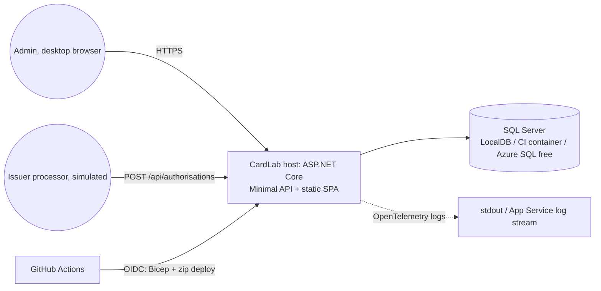
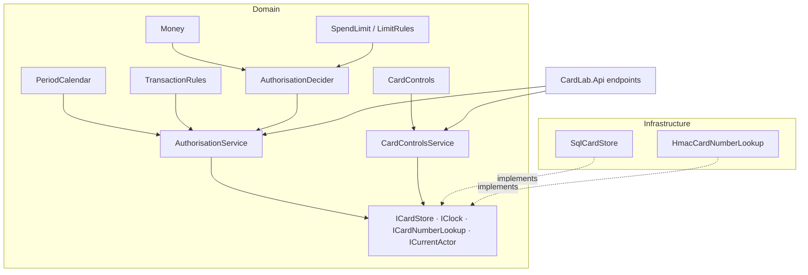

# Card controls: Technical design

## 1. Summary
One deployable: an ASP.NET Core (.NET 10 LTS) host that exposes the card-controls API and serves
the React + TypeScript admin UI as static files, backed by SQL Server (LocalDB locally, a SQL
Server container in CI, the Azure SQL free offer in the cloud). The money path (money, periods,
limits, the authorisation decision) is a pure, dependency-free domain library under
`src/CardLab.Domain/` so it can be property-tested with FsCheck and later marked highest-risk by a
path-based review-tier map. Concurrency (R-12) is solved by serialising all writes to one card
behind a per-card application lock inside the database transaction. The delivery loop is GitHub
Actions: build, xUnit (unit + integration against SQL Server), Playwright (+ axe, keyboard), CodeQL,
ZAP baseline and a ticket-key check on every PR, all against a CI-local instance; a merge to `main`
deploys to one Azure App Service F1 (Linux) through OIDC and Bicep, then runs one smoke journey
against `demo`. Main trade-off: everything in one host and one database, at the cost of no
independent scaling (not a goal at this horizon).

## 2. Engineering context
- **Horizon (from requirements):** long-lived practice product; later features build on this
  harness, data model and audit model.
- **Complexity budget:** invest-in-boundaries: a modular monolith with explicit ports (store,
  clock, card-number lookup, actor), a shared contract suite for the store port, and a pure domain
  for money/limit logic; but still one host, one database, no queues, no microservices, no feature
  flags, no component library.
- **Team & skills:** agent-built (sonnet coders, opus reviewers), human owner reviews gates.
  Mainstream C#/.NET and React/TypeScript idioms only; no exotic libraries.
- **Environments:** local (LocalDB, or any SQL Server via connection string), CI (ephemeral SQL
  Server 2022 service container), one Azure environment `demo` deployed from `main`. No
  preview/staging.
- **Volumes (now → 12 mo):** one business account, 3 seeded cards, hundreds to a few thousand
  transactions; traffic is tests, demos and a reviewer's clicks. Free tiers are ample.
- **Hard constraints / bans:** stack fixed by the README (C#/ASP.NET Core, React + TypeScript,
  SQL Server, Azure, GitHub Actions, xUnit, Playwright, CodeQL, ZAP); Azure cost near £0 and
  nothing that bills by the hour; OIDC only, no stored cloud credentials, no secrets in the repo;
  public repo, fictional data only; card numbers never logged or displayed (NFR-1).

## 3. Decisions
Durable decisions are extracted to `docs/kb/decisions/`: ADR-001 (DEC-3, DEC-6), ADR-002
(DEC-4), ADR-003 (DEC-8, DEC-14), ADR-004 (DEC-5, DEC-9, DEC-10, DEC-11, DEC-18, DEC-21),
ADR-005 (DEC-7, DEC-15, DEC-16, DEC-20, §15).

Decisions DEC-3..DEC-13 were taken on 2026-11-04 (round 1) by the orchestrator under the human's
standing instruction "make all decisions in requirements and tech design including as
recommended"; each took the recommended option.

### DEC-1 Stack and delivery tooling (fixed by the human before this phase)
Decided by the human in the README and the feature launch (2026-11-04), not re-asked here:
C# / ASP.NET Core, React + TypeScript, SQL Server (LocalDB locally, Azure SQL free tier in the
cloud), Azure, GitHub Actions; xUnit and Playwright; CodeQL and an OWASP ZAP baseline scan in CI;
free tiers only; GitHub OIDC to Azure; a small Bicep or Terraform file is acceptable; AI PR review
tiers, CODEOWNERS and triage agents are later features (leave room: money/limit code in clearly
separable paths).

**Chosen:** the README stack. **We give up:** nothing to evaluate; versions pinned in DEC-2.
**Revisit if:** never within this feature.

### DEC-2 Versions (facts looked up 2026-11-04; pin these in PR-00)
| Component | Version | Why |
|---|---|---|
| .NET SDK / runtime | 10.0.x (LTS, supported to 2028-11-14) | current LTS; .NET 9 and 8 leave support 2026-11-10 |
| ASP.NET Core, EF Core (SqlServer provider) | 10.0.x | match the runtime |
| xUnit | xunit.v3 3.2.x (Microsoft.Testing.Platform v1 packages) | current stable v3 line |
| FsCheck | FsCheck.Xunit.v3 3.x | property attribute for xunit v3 (DEC-7) |
| OpenTelemetry | OpenTelemetry.Extensions.Hosting, OpenTelemetry.Exporter.Console, OpenTelemetry.Exporter.OpenTelemetryProtocol, current 1.x | DEC-12 |
| Node.js | 22 LTS | default on GitHub runners; Vite 8 needs 20.19+/22.12+ |
| React / Vite / Vitest | 19.2.x / 8.x / 4.1.x | current stable lines |
| Playwright | @playwright/test 1.63.x; @axe-core/playwright 4.11.x | current stable |
| ZAP | zaproxy/action-baseline v0.12.x (confirm latest tag in PR-00) | official baseline action |
| CodeQL | github/codeql-action v4; C# with `build-mode: none`, javascript-typescript | no build step, slightly fewer alerts; accepted for a first loop |
| Azure actions | azure/login v2 (OIDC), azure/webapps-deploy v3, `az deployment group create` for Bicep | official |

**Chosen:** the lines above; exact patch versions fixed by the coder in PR-00 with `npm view` /
`dotnet package search`. **We give up:** nothing. **Revisit if:** a pinned line reaches end of support.

### DEC-3 Hosting: one App Service F1 (Linux) serving API + SPA
| Criterion | A: App Service F1 (Linux), one app | B: Container Apps consumption, GHCR image | C: Static Web Apps + App Service F1 |
|---|---|---|---|
| Fits requirements | R-10, NFR-3, NFR-4, NFR-5 (60 s warm-up) | R-10, NFR-5; NFR-3 at risk beyond the free grant | R-10, NFR-3 |
| Code we write | smallest: one Bicep module, one deploy step | Dockerfile, registry push, more Bicep | two deploy steps, CORS/linked backend config |
| Test effort & harness | one URL for smoke | one URL | two URLs |
| Complexity | low | medium (containers, cold start) | medium (two resources) |
| Maintainability | plain zip deploy | image lifecycle | two pipelines |
| Run cost | £0 by design (F1 never bills) | £0 until the monthly grant is exceeded, then per-second billing | £0 |
| Lock-in | Azure | Azure + OCI image (portable) | Azure |
| Time to ship | fastest | slower | slower |
| Team familiarity | high | medium | medium |

**Chosen:** A, because it is the only option that cannot bill, and the SPA served from `wwwroot/`
needs no CORS. **We give up:** Always On (cold start after idle, within the 60 s warm-up NFR), a
daily 60 CPU-minute quota (so heavy test runs stay in CI, see §14), independent scaling. .NET 10
on Linux F1 is uncertain at the time of writing, so the deploy publishes self-contained
`linux-x64`. **Revisit if:** the quota is hit in practice or a real processor integration needs
availability. **ADR:** ../../kb/decisions/ADR-001-single-host-app-service-f1.md

### DEC-4 Concurrency: per-card application lock inside the transaction
| Criterion | A: `sp_getapplock` per card in the transaction | B: materialised spend buckets + optimistic retry | C: SERIALIZABLE + deadlock retry |
|---|---|---|---|
| Fits requirements | R-12, AC-21 deterministic | R-12 with retries | R-12 with retries |
| Code we write | ~20 lines in the SQL store | second table, bucket keys, retry loop | retry loop |
| Test effort & harness | one integration burst test | bucket consistency tests + property tests | flaky burst test |
| Complexity | low | medium-high | low but nondeterministic |
| Maintainability | one mechanism for authorisations and control changes | two sources of truth | retries hide bugs |
| Run cost | none | none | none |
| Lock-in | SQL Server specific (`sp_getapplock`) | portable | portable |
| Time to ship | fastest | slowest | fast |
| Team familiarity | high | medium | medium |

**Chosen:** A. Every write to a card (authorisation, freeze/unfreeze, limit change) runs inside
`ICardStore.WithCardLockAsync(cardId, work)`: `BEGIN TRAN; sp_getapplock @Resource='card:{id}',
@LockMode='Exclusive', @LockOwner='Transaction', @LockTimeout=5000`; then read status, limits and
the period sums, decide, append rows, commit. Spend is computed by `SUM(Amount)` over approved
transactions in the period's UTC range (index in §6), no counters to keep consistent.
**We give up:** parallelism within one card (a card is one person; fine) and SQL Server
portability of the store adapter (the port stays portable). **Revisit if:** per-card throughput
ever matters. **ADR:** ../../kb/decisions/ADR-002-per-card-app-lock.md

### DEC-5 CI database: SQL Server 2022 container as a GitHub Actions service on `ubuntu-latest`
| Criterion | A: mssql service container on ubuntu | B: LocalDB on windows-latest | C: Testcontainers.MsSql in test code |
|---|---|---|---|
| Fits requirements | R-9 | R-9 | R-9 |
| Code we write | a `services:` block + env var | a LocalDB start step | NuGet + fixture code |
| Test effort & harness | connection string from env (`CARDLAB_TEST_CONNECTION`), LocalDB default | same | Docker required on dev machines |
| Complexity | low | low | medium |
| Maintainability | image tag pin | runner image dependency (LocalDB only via a VS component) | library + Docker |
| Run cost | free (public repo) | free but slower runners | free |
| Lock-in | none | Windows | Docker |
| Time to ship | fast | fast | medium |
| Team familiarity | high | high | medium |

**Chosen:** A; locally the tests default to `(localdb)\MSSQLLocalDB`, overridable by
`CARDLAB_TEST_CONNECTION`. **We give up:** byte-identical parity between local LocalDB and CI
(both are SQL Server; EF Core hides the rest) and ~20-30 s container start per job.
**Revisit if:** a Linux-only or Windows-only SQL behaviour bites.

### DEC-6 Complexity budget and solution layout
**Chosen:** invest-in-boundaries (see §2) as a modular monolith in three .NET projects plus the
SPA: `src/CardLab.Domain` (pure; money, periods, limits, decision, control changes, ports,
application services), `src/CardLab.Infrastructure` (EF Core model + migrations, `SqlCardStore`,
`HmacCardNumberLookup`, OpenTelemetry wiring), `src/CardLab.Api` (Minimal API host, static SPA,
health, startup migrate + seed), `web/` (SPA), `tests/` (see §15), `infra/` (Bicep),
`.github/workflows/`. Money/limit code exists only under `src/CardLab.Domain/` so a later
path-based risk-tier map can mark that path highest risk. Rejected: a single project (no
dependency firewall for the risk path), and a separate Application project (ceremony for no
boundary benefit at this size). **We give up:** a little project plumbing. **Revisit if:** a
second host (worker, processor adapter) appears.

### DEC-7 Property-based testing: FsCheck.Xunit.v3
**Chosen:** FsCheck.Xunit.v3 (`[Property]` on xunit v3) with custom `Arbitrary` generators in
`tests/CardLab.Domain.Tests/Generators/` for `Money`, `Category`, `Period`, limit sets and
Europe/London instants (including both 2026 DST changes and the hour around them). Rejected:
CsCheck (lighter, less known), hand-rolled random loops (no shrinking). **We give up:** a slightly
F#-flavoured generator API. **Revisit if:** FsCheck's xunit v3 package lags a future xunit major.

### DEC-8 Card-number lookup: HMAC-SHA256 with a configured key
**Chosen:** `LookupHash = HMAC-SHA256(key, PAN digits)` stored as `binary(32)` with a unique
index; the PAN is never stored, logged, returned or displayed (NFR-1). Key from configuration
`CardLab:LookupKey` (base64, 32 bytes): a fixed development key committed in
`appsettings.Development.json` (fictional data; documented as non-secret) and a random key set once
by the human as an App Service application setting for `demo`. Rejected: unkeyed SHA-256 (a
16-digit number is brute-forceable), Azure Key Vault (extra resource and setup for no gain at this
horizon). **We give up:** one more value in the human's one-off setup; rotating the key means
re-seeding the lookup values (the seed recomputes them from the fictional numbers, so a redeploy
heals it). **Revisit if:** real card data ever enters the system (then Key Vault + HSM).
**ADR:** ../../kb/decisions/ADR-003-keyed-card-lookup.md

### DEC-9 Schema and seed at startup
**Chosen:** EF Core migrations (`src/CardLab.Infrastructure/Migrations/`) applied by the host at
startup (`MigrateAsync`), followed by an idempotent seed (`Seeder.EnsureSeedAsync`: account by
name, admin by name, cards by name; lookup hashes recomputed each run). Forward-only; no down
migrations. Rejected: `dotnet ef database update` from the deploy workflow (needs runner-to-SQL
network access and Entra auth from the runner), EF migration bundles (same problem).
**We give up:** a bad migration stops the app at startup; the health endpoint shows it; fix
forward. **Revisit if:** a second instance appears (then a migration lock or a deploy-time step).

### DEC-10 Infrastructure as code: Bicep
**Chosen:** `infra/main.bicep` (+ `infra/demo.bicepparam`): App Service plan F1 Linux, web app
(system-assigned identity, HTTPS only; Bicep sets no app settings, because `deploy.yml` sets them
with `az webapp config appsettings set` (merge), so the lookup key and every other setting survive a
deploy), Azure SQL logical server (Entra-only authentication, the human's identity as admin),
database on the free offer (`useFreeLimit: true`, `freeLimitExhaustionBehavior: AutoPause`),
firewall rule allowing Azure services. Deployed idempotently by `deploy.yml` via `az deployment
group create` after `azure/login` with OIDC. Rejected: portal clicks (undocumented drift),
Terraform (needs a state storage account, extra tooling). **We give up:** nothing beyond Azure
specificity. **Revisit if:** multi-cloud ever matters.

### DEC-11 Database authentication from Azure: managed identity
**Chosen:** the web app's system-assigned identity connects with
`Authentication=Active Directory Default` (Microsoft.Data.SqlClient); no password anywhere.
Human one-off, run once as the SQL server's Entra admin: `CREATE USER [cardlab-demo] FROM
EXTERNAL PROVIDER;` (the web app's name); ALTER ROLE db_ddladmin ADD MEMBER ...; ALTER ROLE db_datareader ...;
ALTER ROLE db_datawriter ...` (ddladmin because migrations run at startup, DEC-9). Locally:
`Server=(localdb)\MSSQLLocalDB;Database=CardLab;Trusted_Connection=True`. Rejected: SQL
authentication with a password in app settings (a stored credential). **We give up:** one T-SQL
step by hand. **Revisit if:** never.

### DEC-12 Structured logs via OpenTelemetry logging
**Chosen:** `builder.Logging.AddOpenTelemetry(o => { o.IncludeScopes = true;
o.IncludeFormattedMessage = true; o.AddConsoleExporter(); if OTLP endpoint configured:
o.AddOtlpExporter(); })`; resource attributes `service.name=cardlab`, `service.version=<commit>`.
Events are `LoggerMessage`-generated methods in `CardLab.Domain/Application/CardLabEvents.cs` (planner decision)
with fixed names and fields: `AuthorisationDecided(cardId, lastFour, category, amount, outcome,
reason, durationMs)` and `ControlChanged(actorId, actorName, cardId, lastFour, action)` (NFR-7).
Integration tests add an in-memory `BaseExporter<LogRecord>` to assert fields and the absence of
16-digit runs (AC-24, AC-39). Rejected: plain JSON console logger (a later export would change the
application). **We give up:** two extra packages in the host now. **Revisit if:** the telemetry
feature picks a backend with its own SDK.

### DEC-13 UI direction: minimal light finance, no component library
| Criterion | A: Minimal/Swiss light, Banking palette, Inter, CSS Modules | B: Dark glassmorphism dashboard, Fira | C: Component library (e.g. MUI) |
|---|---|---|---|
| Fits requirements | NFR-6 contrast and keyboard easy in light mode | contrast risk with blur; mono headings hurt amounts | NFR-6 met by the library |
| Code we write | a few primitives (button, field, table, badge, notice) | same + effects | least |
| Test effort & harness | axe + keyboard in E2E | more contrast fixing | axe + keyboard |
| Complexity | low | medium | medium (theme API) |
| Maintainability | tokens in one CSS file | effects to maintain | library upgrades |
| Run cost | none | none | none |
| Lock-in | none | none | library |
| Time to ship | fast | slower | fastest first screen |
| Team familiarity | high | medium | high |

**Chosen:** A (search matches: style `minimalism-and-swiss-style`; palette
`Banking/Traditional Finance`; typography `Minimal Swiss` (Inter)). The generic
`--design-system` search returned dark glassmorphism (B), rejected for a finance admin tool used
by a non-technical office manager. **We give up:** ready-made accessible primitives (we hand-write
five small ones with native elements). **Revisit if:** a design system is adopted across CardLab.

Decisions DEC-14..DEC-21 were taken on 2026-11-04 (round 2) by the orchestrator under the same
standing instruction; each took the recommended option.

### DEC-14 Authorisation API shape: shared service, simulate by card id, HTTP semantics
**Chosen:** `POST /api/authorisations` (processor: card number) and
`POST /api/cards/{id}/simulate-purchase` (admin UI: card id) both call `AuthorisationService`;
only card resolution differs, so the decision, the stored transaction and the log event are
identical. Status codes: `200` when a decision was made and stored (`approved`, `card_frozen`,
`limit_exceeded`), `404` for `card_not_found`, `400` for `invalid_request` (with a `problems`
list); the body shape is the same in all five cases. Why: NFR-1 forbids the PAN on any UI screen,
so the form cannot call the processor endpoint; requirements decision 5 ("authorisation API +
simulate form") stands, recorded as an erratum in the requirements change log, flagged to the
human at Gate 2. Rejected: the SPA holding card numbers (violates NFR-1); `200` for every reason
(hides errors from clients and ZAP); a separate "simulation" code path (two decision
implementations to keep equal). **We give up:** about 15 lines for the second endpoint.
**Revisit if:** a real processor needs idempotency keys (deferred in requirements).

### DEC-15 Period arithmetic: built-in `TimeZoneInfo` + `DateOnly` + `ISOWeek`
| Criterion | A: built-in .NET | B: NodaTime | C: stored period keys per transaction |
|---|---|---|---|
| Fits requirements | R-4, R-13, AC-13..15, AC-25 | same | same, plus a backfill risk |
| Code we write | ~40 lines of conversion | ~25 lines + edge conversions | 3 derived columns + write-time logic |
| Test effort & harness | property tests over DST (needed anyway) | same | same plus migration tests |
| Complexity | low | one more API to learn | medium |
| Maintainability | framework-maintained tz data (ICU/IANA) | library upgrades, EF mapping | schema coupling to period rules |
| Run cost | none | none | none |
| Lock-in | none | NodaTime types in the domain | schema |
| Time to ship | fast | fast | slower |
| Team familiarity | high | medium | medium |

**Chosen:** A. `PeriodCalendar` converts the instant to Europe/London
(`TimeZoneInfo.FindSystemTimeZoneById("Europe/London")`, cached), takes the local `DateOnly`,
derives the period's first local day (day: itself; week: Monday via `DayOfWeek`; month: day 1),
and converts `[localStart 00:00, localEnd 00:00)` back to UTC instants with
`GetUtcOffset`-aware conversion (`TimeZoneInfo.ConvertTimeToUtc` on an unspecified-kind
`DateTime`; the DST-gap/overlap cases are covered by the property tests, which assert each instant
lands in exactly one period and that consecutive periods tile the timeline). **We give up:**
NodaTime's self-documenting types. **Revisit if:** a second business time zone appears.

### DEC-16 Test-only reset endpoint
**Chosen:** `POST /api/test/reset` (delete transactions, audit events and limits; set the seeded
cards to active) is mapped only when `CardLab:TestEndpoints=true`; set in
`appsettings.Development.json` and the CI `e2e` job; never set by Bicep or the deploy workflow;
`T-I-15` asserts `404` when the flag is off; the Playwright `smoke` project never calls it.
Rejected: journeys tolerant of leftover state (brittle assertions), per-test cards (no issuance in
this feature). **We give up:** one conditional endpoint to keep out of `demo`. **Revisit if:**
card issuance arrives (then tests create their own cards).

### DEC-17 Design-system file not persisted
**Chosen:** §4.1 is the source of truth; tokens are implemented once in
`web/src/styles/tokens.css`; no `docs/design-system/` output (the generated MASTER.md would carry
the rejected glassmorphism direction). **We give up:** a standalone file for later features (they
read §4.1 via the KB link). **Revisit if:** a second feature with UI starts.

### DEC-18 E2E and ZAP placement; ZAP policy
**Chosen:** the full Playwright suite (journeys, axe, keyboard, formatting, privacy) and the ZAP
baseline run CI-local on every PR against the published host + mssql service; after a deploy only
the `smoke` project (one J-1 journey on "Ops van", restoring the card to active, plus the AC-36
timing) runs against `demo`. ZAP: `zaproxy/action-baseline` with `fail_action: true`, so only
FAIL-level alerts fail the job; WARN-level findings are either fixed or listed in
`.zap/rules.tsv` with a one-line reason, reviewed like code. Rejected: full suite against `demo`
(spends the F1 daily quota, cannot run before merge, shared state), no smoke on `demo` (G-1's
deployed journey would be manual). **We give up:** ~2-3 minutes per PR to build and start the host
in the `e2e` job. **Revisit if:** the quota is still hit by smoke runs (then run smoke only on
`workflow_dispatch`).

### DEC-19 HTTP API style: Minimal APIs
**Chosen:** Minimal APIs with endpoint groups (`MapGroup("/api/cards")`,
`MapGroup("/api/authorisations")`), `TypedResults`, built-in ProblemDetails
(`AddProblemDetails`) and OpenAPI document generation for the reviewer. Endpoints are thin: parse
route/body, call the service, map `Result` to a status. Rejected: MVC controllers (ceremony,
DataAnnotations would duplicate domain rules), FastEndpoints (third-party framework for 11
endpoints). **We give up:** the MVC filter ecosystem. **Revisit if:** the API grows past a few
dozen endpoints with cross-cutting policies.

### DEC-20 Frontend tooling
**Chosen:** Vite 8 + React 19.2 + TypeScript (`strict`), React Router (routes `/` and
`/cards/:id`), `ApiClient` interface with `HttpApiClient` (fetch) and `FakeApiClient`, Vitest +
Testing Library (jsdom), ESLint (typescript-eslint, react-hooks, jsx-a11y) + Prettier,
`@fontsource/inter`, CSS Modules + `tokens.css`. Rejected: TanStack Query (caching for two pages
that refetch after each action), Next.js (SSR and a Node server for an admin SPA served by
ASP.NET Core). **We give up:** ~50 lines of hand-written loading/error state. **Revisit if:** the
UI grows beyond a handful of pages.

### DEC-21 CI policy details
**Chosen:** `ticket-key` job first in `ci.yml` on `pull_request` events, regex from
`vars.TICKET_KEY_PATTERN` (default `CL-\d+`) applied to title and body; lint gates
`dotnet format --verify-no-changes`, ESLint and `prettier --check`; `dotnet build -warnaserror`
with `<Nullable>enable</Nullable>` and `<TreatWarningsAsErrors>`; the human enables branch
protection on `main` requiring `ci / backend`, `ci / web`, `ci / e2e`, `ci / ticket-key` and
CodeQL (documented in `docs/ops/azure-setup.md`). Rejected: a GitHub App or external tracker
integration (deferred by requirements), warnings allowed (they accumulate). **We give up:** a few
extra coder fix cycles early. **Revisit if:** a tracker with different keys is wired up (change
the variable, not the workflow).

## 4. Architecture

Containers and responsibilities:
- **CardLab host** (`src/CardLab.Api`): Minimal API endpoint groups (§7), ProblemDetails,
  static files for the SPA (Vite build copied into `wwwroot/` at publish, `MapFallbackToFile`),
  health endpoint, startup migrate + seed, test-only endpoints when enabled (§11).
- **Domain** (`src/CardLab.Domain`): `Money`, `PeriodCalendar`, `SpendLimit`, `AuthorisationDecider`,
  `TransactionRules`, `CardControls`, ports and application services. No framework or I/O
  dependencies; the high-risk path.
- **Infrastructure** (`src/CardLab.Infrastructure`): EF Core `CardLabDbContext` + migrations,
  `SqlCardStore` (with the per-card lock), `HmacCardNumberLookup`, `SystemClock`,
  `SeededAdminActor`, logging events and OpenTelemetry wiring, `Seeder`.
- **Admin UI** (`web/`): React + TypeScript SPA: card list (`/`), card detail (`/cards/:id`).
- **Delivery** (`.github/workflows/ci.yml`, `codeql.yml`, `deploy.yml`; `infra/`).



### 4.1 UI/UX design
Run with `sdlc:ui-ux-pro-max` on 2026-11-04 (stack detected as React + TypeScript from the README;
no existing brand files). Searches: `--design-system "fintech admin dashboard business card controls
finance"` (top hit glassmorphism, rejected in DEC-13), `--domain style "admin panel finance minimal
light professional"` (match: Minimalism & Swiss Style), `--domain color "fintech banking trust
professional light"` (match: Banking/Traditional Finance), `--domain typography "admin dashboard data
tables professional"` (match: Minimal Swiss, Inter), `--domain ux` for error placement, colour-only
status, table overflow and submit feedback, `--stack react` for forms.

- **Direction / style:** Minimalism & Swiss: white space, 1 px borders, no shadows, one accent,
  clear type hierarchy, subtle 150-250 ms transitions (DEC-13).
- **Tokens** (`web/src/styles/tokens.css`, CSS custom properties; components never use raw hex):
  palette primary `#0F172A` / on-primary `#FFFFFF`, secondary `#1E3A8A`, accent `#A16207` /
  on-accent `#FFFFFF`, background `#F8FAFC`, foreground `#020617`, card `#FFFFFF`, muted
  `#E8ECF1`, muted-foreground `#475569`, border `#E2E8F0`, destructive `#DC2626` / on-destructive
  `#FFFFFF`, ring `#0F172A`; status: active `#166534` on `#DCFCE7`, frozen `#1E3A8A` on `#DBEAFE`,
  approved `#166534`, declined `#991B1B` on `#FEE2E2`. Type: Inter (self-hosted via
  `@fontsource/inter`, no runtime Google Fonts call), base 16 px, line-height 1.5, scale 14/16/20/24/32,
  `font-variant-numeric: tabular-nums` on amounts. Spacing scale 4/8/12/16/24/32/48 px; radius 4 px;
  focus ring 2 px solid `--color-ring` with 2 px offset.
- **Layout pattern per page:** app shell with a header (CardLab, "Brightline Supplies Ltd",
  "Sam Ellis"), content max-width 1200 px. *Card list* (`/`): one table (name, cardholder, last
  four, status badge, "Open" link). *Card detail* (`/cards/:id`): heading with name, last four and
  status badge + Freeze/Unfreeze button; two columns at ≥ 1024 px, stacked below: left "Spend
  limits" (table + inline add/edit form: category select, period select, amount input, Save;
  Remove per row) and "Audit" (list newest first); right "Simulate purchase" (amount, category,
  merchant; result notice with outcome and reason) and "Transactions" (table newest first). No
  modals; every action is a form or button with inline feedback.
- **Design-system file:** not persisted (the tokens above are the source; DEC-17).

| Rule (checkable) | Source | Traced to | Checked by |
|---|---|---|---|
| Text contrast ≥ 4.5:1 on every page; non-text UI ≥ 3:1 | style match (Minimalism requires `contrast-text-4.5`) | NFR-6, AC-37 | E2E axe (T-E-5) |
| Every action reachable and operable by keyboard; focus ring visible, never removed | ux priority 1 | NFR-6, AC-37 | E2E keyboard journeys (T-E-5) |
| Every input has a visible `<label>`; errors inline under the field with `aria-describedby`, announced with `role="alert"` | ux match "Error Placement", "Error Messages" | AC-9, AC-20, AC-22 | E2E (T-E-2, T-E-3), web unit (T-W-3) |
| Status (active/frozen, approved/declined) shown as text in a badge, never colour alone | ux match "Color Only" | AC-22, AC-23 | E2E text assertions, axe |
| Submit feedback: button shows pending state, then a success/error notice | ux match "Submit Feedback" | AC-22 | E2E (T-E-3) |
| Amounts rendered `£1,234.56`; times rendered in Europe/London as `25 Oct 2026 00:30` | NFR-6 | AC-38 | web unit (T-W-1, T-W-2), E2E (T-E-6) |
| Tables wrapped in an `overflow-x: auto` container; no horizontal page scroll at 1024-1440 px | ux match "Table Handling" | NFR-6 | E2E viewport check (T-E-5) |
| `prefers-reduced-motion` disables transitions | style match accessibility requirements | NFR-6 | review (CSS) |
| Buttons ≥ 44 px tall, ≥ 8 px apart | ux priority 2 (general fallback for desktop) | NFR-6 | review (CSS tokens) |
| Icons: none in this feature (text labels only); if added later, SVG with accessible names | ux priority 4 | NFR-6 | review |
| Semantic HTML: `<button>`, `<table>`, `<form>`, `<nav>`; no `div` click handlers | stack match react "Use semantic HTML" | AC-37 | review + axe |

**Anti-patterns to avoid:** emoji or icon-only controls; placeholder-only labels; toast-only
errors; colour-only status; modals for simple actions; raw hex in components; removing focus
outlines; mono fonts for amounts.

## 5. Modules & interfaces (seams)
| Module | Responsibility | Public interface (signatures) | Depends on (ports) |
|--------|----------------|-------------------------------|--------------------|
| `CardLab.Domain.Money` | GBP value, 2 dp, pence-exact | `readonly record struct Money`: `static Money Zero`, `static bool TryFromDecimal(decimal, out Money)` (rejects > 2 dp), `decimal Amount`, `+`, `-` (floors at zero via `Money.Max`), comparison operators, `ToString() → "1234.56"`; `MoneyBounds.IsValidTransactionAmount(Money)` (£0.01..£1,000,000.00), `MoneyBounds.IsValidLimitAmount(Money)` (£0.00..£1,000,000.00) | none |
| `CardLab.Domain.Periods` | Europe/London calendar periods | `enum Period { Day, Week, Month }`; `static class PeriodCalendar`: `PeriodRange RangeContaining(DateTimeOffset instant, Period period)` → `record PeriodRange(DateTimeOffset StartUtc, DateTimeOffset EndUtcExclusive, DateOnly LocalStart)` | none (`TimeZoneInfo`, DEC-15) |
| `CardLab.Domain.Limits` | limit model | `enum Category { Travel, Fuel, MealsAndEntertainment, SoftwareAndSubscriptions, OfficeSupplies, Advertising, ProfessionalServices, Other }`; `record SpendLimit(Category Category, Period Period, Money Amount)`; `record LimitWithSpend(SpendLimit Limit, Money ApprovedSpendInPeriod)`; `record LimitRemaining(Category, Period, Money Limit, Money Remaining)` | none |
| `CardLab.Domain.Authorisation` | the pure decision | `enum Outcome { Approved, Declined }`; `enum Reason { Approved, CardFrozen, LimitExceeded, CardNotFound, InvalidRequest }`; `record Decision(Outcome, Reason, IReadOnlyList<LimitRemaining> Limits)`; `static Decision AuthorisationDecider.Decide(CardStatus status, IReadOnlyList<LimitWithSpend> limitsInCategory, Money amount)`; `static Result<ValidatedAuthorisation, Reason> TransactionRules.Validate(AuthorisationRequest raw)` (`record ValidatedAuthorisation(string CardNumberDigits, Money Amount, Category Category, string Merchant, DateTimeOffset OccurredAt)`) | none |
| `CardLab.Domain.Controls` | control changes + audit | `enum CardStatus { Active, Frozen }`; `enum AuditAction { Freeze, Unfreeze, LimitSet, LimitChanged, LimitRemoved }`; `record AuditEvent(CardId, Actor, DateTimeOffset AtUtc, AuditAction, string? OldValue, string? NewValue)`; `static class CardControls`: `ControlChange<CardStatus>? Freeze(CardStatus, CardRef, Actor, DateTimeOffset nowUtc)`, `Unfreeze(...)`, `ControlChange<SpendLimit> SetLimit(SpendLimit? existing, SpendLimit requested, ...)`, `ControlChange<SpendLimit>? RemoveLimit(SpendLimit? existing, ...)`; `record ControlChange<T>(T NewState, AuditEvent Event)` (null = no-op, no event) | none |
| `CardLab.Domain.Ports` | seams | `interface IClock { DateTimeOffset UtcNow { get; } }`; `interface ICardNumberLookup { LookupHash Compute(string digits); }`; `interface ICurrentActor { Actor Current { get; } }`; `interface ICardStore` (below) | — |
| `ICardStore` | persistence port | `Task<IReadOnlyList<CardSummary>> ListCardsAsync(ct)`; `Task<CardDetail?> GetCardAsync(CardId, ct)`; `Task<CardId?> FindByLookupAsync(LookupHash, ct)`; `Task<T> WithCardLockAsync<T>(CardId, Func<ICardWriter, Task<T>> work, ct)`; `Task<IReadOnlyList<TransactionRecord>> ListTransactionsAsync(CardId, ct)` (newest first); `Task<IReadOnlyList<AuditEvent>> ListAuditAsync(CardId, ct)` (newest first) | — |
| `ICardWriter` (inside the lock) | atomic unit of work | `Task<CardState> GetStateAsync()` (status + limits); `Task<Money> SumApprovedSpendAsync(Category, PeriodRange)`; `void AppendTransaction(TransactionRecord)`; `void AppendAudit(AuditEvent)`; `void SetStatus(CardStatus)`; `void UpsertLimit(SpendLimit)`; `void RemoveLimit(Category, Period)` (changes are flushed on commit when `work` returns) | — |
| `CardLab.Domain.Application` | orchestration | `AuthorisationService.AuthoriseAsync(AuthorisationRequest, ct) → AuthorisationResult` (`record AuthorisationResult(Decision, TransactionId?)`), `AuthorisationService.AuthoriseByCardIdAsync(CardId, SimulatedPurchase, ct)` (same path after card resolution; DEC-14); `CardControlsService.FreezeAsync(CardId, ct)`, `UnfreezeAsync`, `SetLimitAsync(CardId, Category, Period, decimal amount, ct)`, `RemoveLimitAsync(CardId, Category, Period, ct)`; all return `Result<T, DomainError>` with `DomainError { CardNotFound, InvalidAmount }` | `ICardStore`, `IClock`, `ICardNumberLookup`, `ICurrentActor`, `ILogger` |
| `CardLab.Infrastructure.Sql` | real store | `SqlCardStore : ICardStore` (EF Core, `sp_getapplock` in `WithCardLockAsync`), `CardLabDbContext`, `Seeder.EnsureSeedAsync(IServiceProvider, SeedOptions)` | SQL Server |
| `CardLab.Infrastructure.Lookup` | one-way lookup | `HmacCardNumberLookup : ICardNumberLookup` (key from `IOptions<LookupOptions>`) | — |
| `CardLab.Infrastructure.Logging` | wiring (`CardLabEvents` lives in `CardLab.Domain/Application/CardLabEvents.cs`) | `static partial class CardLabEvents` (LoggerMessage), `AddCardLabTelemetry(this IHostApplicationBuilder)` | OpenTelemetry |
| `CardLab.Api` | HTTP (§7), health, static SPA | `MapCardEndpoints`, `MapAuthorisationEndpoints`, `MapHealthEndpoint`, `MapTestEndpoints` (conditional) | Application |
| `web/src/api` | SPA port | `interface ApiClient` (one method per endpoint in §7) with `HttpApiClient` and `FakeApiClient` | HTTP |
| `web/src/format` | presentation rules | `formatMoney(amount: string): string`, `formatLondonTime(iso: string): string` | none |

## 6. Data model & migrations
EF Core model in `src/CardLab.Infrastructure/Model/`, migrations in `.../Migrations/`
(first migration `InitialCardControls`). Amounts are `decimal(12,2)`; the domain `Money` maps to
and from it. Enums are stored as short strings (`varchar(40)`) for readable rows and stable audit
values.

| Table | Columns | Keys / indexes |
|---|---|---|
| `BusinessAccount` | `Id uniqueidentifier`, `Name nvarchar(200)`, `TimeZoneId varchar(64)` (= `Europe/London`) | PK Id; unique Name |
| `AdminUser` | `Id`, `AccountId`, `DisplayName nvarchar(200)` | PK; FK Account; unique (AccountId, DisplayName) |
| `Card` | `Id`, `AccountId`, `Name nvarchar(100)`, `CardholderName nvarchar(200)`, `LastFour char(4)`, `LookupHash binary(32)`, `Status varchar(20)` | PK; FK Account; unique LookupHash; unique (AccountId, Name) |
| `SpendLimit` | `Id`, `CardId`, `Category varchar(40)`, `Period varchar(10)`, `Amount decimal(12,2)` | PK; FK Card; unique (CardId, Category, Period) |
| `Transaction` | `Id`, `CardId`, `Amount decimal(12,2)`, `Category`, `Merchant nvarchar(200)`, `OccurredAt datetimeoffset(0)` (as supplied), `DecidedAtUtc datetime2(3)`, `Outcome varchar(10)`, `Reason varchar(20)` | PK; FK Card; index `IX_Transaction_Spend (CardId, Category, Outcome, OccurredAt) INCLUDE (Amount)`; index `(CardId, DecidedAtUtc DESC)` for history |
| `AuditEvent` | `Id`, `CardId`, `ActorId`, `ActorName nvarchar(200)`, `AtUtc datetime2(3)`, `Action varchar(20)`, `OldValue nvarchar(400) null`, `NewValue nvarchar(400) null` | PK; FK Card; index `(CardId, AtUtc DESC)` |

Rules: `Transaction` and `AuditEvent` are append-only (no update/delete code paths; the EF model
marks them with no `Update`/`Remove` usage, enforced by review). Spend for a limit = `SUM(Amount)`
where `CardId`, `Category`, `Outcome = 'Approved'` and `OccurredAt >= StartUtc AND OccurredAt <
EndUtcExclusive` (`datetimeoffset` compares by instant). Old/new values are small strings
(`"Active"`, `"Frozen"`, `"Fuel/Day/50.00"`).

Seed (`Seeder`, idempotent by name): account "Brightline Supplies Ltd" (Europe/London); admin
"Sam Ellis"; cards "Ops van" (cardholder "Priya Nair", number `9999 0001 0000 0001`, last four
`0001`), "Field sales" ("Tom Okafor", `9999 0001 0000 0002`), "Marketing" ("Leah Brooks",
`9999 0001 0000 0003`). The numbers are fictional (no Luhn validity required); they live in
`SeedOptions` (`appsettings.json`, non-secret) so tests and the deploy smoke can use them; the
database stores only their lookup hash and last four.

## 7. APIs & contracts
JSON, UTF-8, under `/api`. Amounts are decimal strings with two places (`"50.00"`) in and out;
timestamps ISO-8601 with offset. Errors for the admin endpoints use RFC 9457 ProblemDetails
(`application/problem+json`) with `errors` for validation. No authentication in this feature;
the actor is the seeded admin (`ICurrentActor`).

| Method & path | Request | Response | Notes |
|---|---|---|---|
| `GET /api/cards` | — | `200 [{id, name, cardholderName, lastFour, status}]` | R-8 |
| `GET /api/cards/{id}` | — | `200 {id, name, cardholderName, lastFour, status, limits:[{category, period, amount}]}`; `404` | R-4, R-8 |
| `POST /api/cards/{id}/freeze` | — | `200 {status:"frozen"}`; `404` | R-1; no-op if already frozen (no audit) |
| `POST /api/cards/{id}/unfreeze` | — | `200 {status:"active"}`; `404` | R-2 |
| `PUT /api/cards/{id}/limits/{category}/{period}` | `{amount}` | `200 {category, period, amount}`; `400` ProblemDetails (amount outside R-11, unknown category/period); `404` | R-4; replaces an existing limit; audit `limit_set` or `limit_changed` |
| `DELETE /api/cards/{id}/limits/{category}/{period}` | — | `204`; `404` card unknown | R-4; no-op without audit if no such limit |
| `GET /api/cards/{id}/transactions` | — | `200 [{id, occurredAt, amount, category, merchant, outcome, reason}]` newest first | R-7, R-8 |
| `GET /api/cards/{id}/audit` | — | `200 [{id, atUtc, actorName, action, oldValue, newValue}]` newest first | R-6 |
| `POST /api/authorisations` | `{cardNumber, amount, category, merchant, timestamp}` | decision body (below); `200` for `approved`, `card_frozen`, `limit_exceeded`; `404` `card_not_found`; `400` `invalid_request` (DEC-14) | R-7, the processor API |
| `POST /api/cards/{id}/simulate-purchase` | `{amount, category, merchant, timestamp?}` (timestamp defaults to `IClock.UtcNow`) | decision body | R-8; same service path and status codes as above after resolving the card by id (DEC-14) |
| `GET /api/health` | — | `200 {commit, database:"ok"}` or `503 {commit, database:"unreachable"}` | R-14 |
| `POST /api/test/reset` | — | `204` | only when `CardLab:TestEndpoints=true` (DEC-16) |

Decision body: `{ outcome: "approved"|"declined", reason: "approved"|"card_frozen"|"limit_exceeded"|
"card_not_found"|"invalid_request", transactionId: uuid|null, limits: [{category, period, limit,
remaining}] }`. `limits` lists every limit on the card in the request's category with
`remaining = max(0, limit - approved spend in that period after this decision)`; empty for unknown
cards and invalid requests. Category and period names on the wire: `travel`, `fuel`,
`meals_and_entertainment`, `software_and_subscriptions`, `office_supplies`, `advertising`,
`professional_services`, `other`; `day`, `week`, `month`. Status names: `active`, `frozen`.

## 8. Key flows
```mermaid
sequenceDiagram
  participant P as Processor / simulate form
  participant A as Api endpoint
  participant S as AuthorisationService
  participant D as Domain (TransactionRules, PeriodCalendar, Decider)
  participant St as SqlCardStore
  P->>A: POST /api/authorisations {cardNumber, amount, category, merchant, timestamp}
  A->>S: AuthoriseAsync(request)
  S->>D: TransactionRules.Validate(raw)
  alt invalid
    S-->>A: Decision(declined, invalid_request); nothing stored
  else valid
    S->>St: FindByLookupAsync(Hmac(cardNumber))
    alt unknown card
      S-->>A: Decision(declined, card_not_found); nothing stored
    else known card
      S->>St: WithCardLockAsync(cardId, work)
      St->>St: BEGIN TRAN; sp_getapplock card:{id}
      S->>St: GetStateAsync() (status, limits)
      loop each limit in the category
        S->>D: PeriodCalendar.RangeContaining(timestamp, period)
        S->>St: SumApprovedSpendAsync(category, range)
      end
      S->>D: AuthorisationDecider.Decide(status, limitsWithSpend, amount)
      S->>St: AppendTransaction(record with outcome, reason)
      St->>St: COMMIT (lock released)
      S->>S: log AuthorisationDecided (duration measured from request start)
      S-->>A: Decision + transactionId
    end
  end
  A-->>P: decision body
```

```mermaid
sequenceDiagram
  participant U as Admin UI
  participant A as Api endpoint
  participant C as CardControlsService
  participant St as SqlCardStore
  U->>A: PUT /api/cards/{id}/limits/fuel/day {amount:"80.00"}
  A->>C: SetLimitAsync(id, Fuel, Day, 80.00)
  C->>C: MoneyBounds.IsValidLimitAmount → else InvalidAmount (400, nothing stored)
  C->>St: WithCardLockAsync(id, work)
  C->>St: GetStateAsync()
  C->>C: CardControls.SetLimit(existing Fuel/Day 50.00, requested 80.00, actor, now) → (limit, AuditEvent limit_changed 50.00→80.00)
  C->>St: UpsertLimit; AppendAudit
  St->>St: COMMIT
  C->>C: log ControlChanged
  C-->>A: limit
  A-->>U: 200 {category, period, amount}
```
Decision order inside `Decide`: frozen → `card_frozen`; else if any limit in the category has
`spend + amount > limit` → `limit_exceeded`; else `approved`. `remaining` is computed after the
decision (approved: spend + amount; declined: spend). Period sums are computed inside the lock, so
a limit change and an authorisation on the same card never interleave (R-12, R-13).

## 9. Errors & failure modes
| Failure | Detection | Behaviour | User sees |
|---------|-----------|-----------|-----------|
| Malformed authorisation request (missing amount, £0.00, > 2 dp, unknown category, bad timestamp, card number not 16 digits, merchant containing 13 or more digits) | `TransactionRules.Validate` | no DB access, nothing stored, `invalid_request` | decision body with reason `invalid_request` and a `problems` list (simulate form shows them inline). Rules (BUG-004, BUG-005): "bad timestamp" = not strict ISO-8601 with an explicit offset (`yyyy-MM-ddTHH:mm:ss[.fff](Z\|±hh:mm)`) or outside [2000-01-01T00:00Z, 2100-01-01T00:00Z), reported as a `timestamp` problem; a merchant with a run of 13+ digits (optionally separated by spaces or dashes) is a `merchant` problem, so no card number can be stored or displayed via the merchant (NFR-1) |
| Unknown card number | `FindByLookupAsync` returns null | nothing stored, `card_not_found` | decision body |
| Limit amount outside R-11 or unknown category/period on the admin API | endpoint binding + `MoneyBounds` | `400` ProblemDetails, nothing stored, no audit | inline field error (AC-9) |
| Unknown card id on the admin API | store returns null | `404` ProblemDetails | "Card not found" page notice |
| App-lock timeout (5 s) under extreme contention | `sp_getapplock` returns < 0 | transaction rolled back, `503` ProblemDetails, nothing stored | "Try again" notice |
| Database unreachable | SqlClient exception | request fails `503`; `/api/health` reports `database:"unreachable"` | "Service unavailable" notice |
| Migration fails at startup | host exits non-zero | App Service shows the previous process stopped; deploy workflow's health wait fails the run | deploy workflow red; fix forward |
| Serverless database resuming after idle auto-pause (60 min) | connection failures during resume | startup retries migrate + seed for up to 120 s; the demo connection string uses `Connect Timeout=60`, `Connect Retry Count=3`, `Connect Retry Interval=10`; requests during resume → `503` | "Service unavailable" notice |
| Free-offer database auto-paused (quota exhausted) | connection failures | as "database unreachable" | same |
| F1 CPU quota exhausted | App Service returns 403 | nothing to do; resets at 00:00 UTC | 403 page |
| SPA route reload (`/cards/{id}`) | static file miss | `MapFallbackToFile("index.html")` | the page |

## 10. Security & privacy
- **NFR-1 (no PAN anywhere):** the PAN enters only in `POST /api/authorisations`; it is hashed by
  `HmacCardNumberLookup` in the service before anything else is logged or stored; `LastFour` is
  derived at seed time. The request DTO's `cardNumber` is excluded from model-binding logs and
  ProblemDetails; `ToString` on the request record is overridden to mask it. The simulate form
  works by card id so the UI never handles a PAN (DEC-14). Tests scan logs, responses, rows and
  screens for 16-digit runs (AC-24).
- **Lookup key:** DEC-8; the Azure key is never in GitHub.
- **Input validation:** all admin inputs validated in the domain (`MoneyBounds`, enum parsing);
  EF Core parameterises SQL; `sp_getapplock` is called with a parameter.
- **No auth in this feature** (requirements decision 4); endpoints are shaped so a later auth
  feature adds a policy and replaces `SeededAdminActor` without touching services.
- **Transport:** HTTPS only on App Service (`httpsOnly: true`, TLS 1.2 minimum); HSTS and
  `X-Content-Type-Options`, `Referrer-Policy`, a conservative `Content-Security-Policy` for the
  SPA (self only, no inline scripts; Vite build output is CSP-friendly), set by a small header
  middleware so ZAP's baseline passes without exceptions.
- **Static scanning:** CodeQL (C# `build-mode: none`, javascript-typescript) on PRs and `main`.
- **Dynamic scanning:** ZAP baseline (passive) against the CI-local instance (§14, DEC-18).
- **Secrets:** none in the repo; GitHub secret scanning stays enabled; OIDC federated credential
  scoped to `repo:<owner>/cardlab:ref:refs/heads/main` (and `environment:demo`).
- **Test endpoints:** `/api/test/*` mapped only when `CardLab:TestEndpoints=true`; the Bicep
  never sets it (DEC-16).

## 11. Configuration & secrets
| Key | Local (`appsettings.Development.json`) | CI | Azure `demo` (App Service settings set by `deploy.yml` with `az webapp config appsettings set` (merge); Bicep sets none) | Secret? |
|---|---|---|---|---|
| `ConnectionStrings:CardLab` | `Server=(localdb)\MSSQLLocalDB;Database=CardLab;Trusted_Connection=True;TrustServerCertificate=True` | `Server=localhost,1433;Database=CardLab;User Id=sa;Password=<job-generated>;TrustServerCertificate=True` (password generated per job, not stored) | `Server=tcp:<server>.database.windows.net;Database=cardlab;Authentication=Active Directory Default;Encrypt=True` | no (no password) |
| `CardLab:LookupKey` | fixed dev key (committed, documented non-secret) | same dev key | random 32-byte base64 set by the human once in the portal/CLI; not touched by Bicep or by the deploy (merge preserves it) | yes (outside GitHub) |
| `CardLab:TestEndpoints` | `true` | `true` for the E2E job | unset (false) | no |
| `CardLab:Commit` | `local` | `${GITHUB_SHA}` | unset; health reports the source revision after the last '+' of the informational version stamped by `-p:SourceRevisionId` | no |
| `OTEL_EXPORTER_OTLP_ENDPOINT` | unset | unset | unset (a later feature sets it) | no |
| `CardLab:Seed:*` | in `appsettings.json` | same | same | no (fictional) |
| Repo variables (`vars.*`) | — | `TICKET_KEY_PATTERN` (default `CL-\d+`), `AZURE_CLIENT_ID`, `AZURE_TENANT_ID`, `AZURE_SUBSCRIPTION_ID`, `AZURE_RESOURCE_GROUP`, `AZURE_WEBAPP_NAME`, `AZURE_SQL_SERVER_NAME`, `AZURE_SQL_ADMIN_LOGIN`, `AZURE_SQL_ADMIN_OBJECT_ID`, `DEMO_URL` | — | no (identifiers, not credentials) |

Human one-off setup (documented in `docs/ops/azure-setup.md`, written in the deploy PR): resource
group; Entra app registration or user-assigned identity with a federated credential for the repo's
`main` branch and `demo` environment, `Contributor` on the resource group; the repo variables
above; after the first Bicep run: the SQL user for the web app's identity (DEC-11) and the
`CardLab__LookupKey` app setting.

## 12. Observability
- **Logs (NFR-7):** DEC-12. `AuthorisationDecided` fields: `CardId`, `LastFour`, `Category`,
  `Amount`, `Outcome`, `Reason`, `DurationMs`; `ControlChanged` fields: `ActorId`, `ActorName`,
  `CardId`, `LastFour`, `Action`. Exactly one event per decision/change, emitted by the services
  (not the endpoints), so the simulate path and the processor path log identically. Request logging
  stays at the default ASP.NET Core level (no body logging, so no PAN).
- **Health (R-14):** `GET /api/health` runs `SELECT 1` with a 5 s timeout; returns the commit
  from `CardLab:Commit` when set (local, CI); on `demo` it is unset and health reports the source revision after the last '+' of the informational version stamped by `-p:SourceRevisionId`. Used by the deploy workflow to
  confirm the new build (AC-27, AC-34).
- **Not in this feature:** metrics, traces, dashboards (the OTel SDK is present; adding
  `WithTracing/WithMetrics` later is configuration-only).

## 13. Performance (per NFR)
- **NFR-5 decision ≤ 300 ms p95 locally with 1,000 transactions:** the hot path is one lookup by
  unique hash, one locked transaction with one state read and at most three indexed `SUM`s over
  `IX_Transaction_Spend` (range seek on `OccurredAt` within `(CardId, Category, Outcome)`), one
  insert. Expected well under 50 ms on LocalDB; AC-35 measures it (T-I-14).
- **NFR-5 simulate round trip ≤ 2 s warm on `demo`:** the SPA calls one endpoint; Azure SQL free
  offer latency in-region is low; AC-36 measured by the smoke run (T-E-7).
- **NFR-5 warm-up ≤ 60 s:** self-contained publish, startup does migrate + seed (two short queries
  when nothing changes); deploy workflow polls health for up to 5 min to absorb the free-offer
  database's own resume time; the deploy does not assert 60 s, the validator measures warm-up after
  idle (T-C-2). Startup also retries migrate + seed for up to 120 s while the database resumes (§9).
- **SPA:** Vite production build, single bundle under ~200 kB gzipped (no component library),
  fonts self-hosted.

## 14. Rollout & rollback
- **CI (`ci.yml`, on `pull_request` and on `push` to `main` and `feat/**`):** jobs `ticket-key`
  (PR only; title and body must match `vars.TICKET_KEY_PATTERN`, default `CL-\d+`), `backend`
  (ubuntu + mssql 2022 service: `dotnet build -warnaserror`, unit, integration), `web` (`npm ci`,
  lint, typecheck, Vitest, build), `e2e` (needs backend + web: publish the host with the SPA, start
  it with the mssql service and `CardLab:TestEndpoints=true`, Playwright full suite with axe and
  keyboard journeys, then ZAP baseline against the same local URL). `codeql.yml`: C# and
  JavaScript/TypeScript on PRs, `main` and weekly. All of this runs against a CI-local instance:
  the F1 quota (60 CPU-minutes/day) is never spent by PR runs.
- **Deploy (`deploy.yml`, on `push` to `main` and `workflow_dispatch`, environment `demo`):**
  build + publish self-contained `linux-x64` with `-p:SourceRevisionId=$GITHUB_SHA`;
  `azure/login` (OIDC); `az deployment group create -f infra/main.bicep -p infra/demo.bicepparam`;
  `azure/webapps-deploy` (zip); wait for `GET /api/health` to report `commit == $GITHUB_SHA` and
  `database: ok` (poll up to 5 min); run the Playwright `smoke` project only: one J-1 journey on
  "Ops van" (freeze → simulate purchase declined `card_frozen` → unfreeze → simulate approved,
  leaving the card active) plus the simulate timing assertion (AC-36). One smoke run costs seconds
  of the daily F1 quota; the full suite never runs against `demo`.
- **Rollback:** re-run the last green `deploy` run (Actions → Re-run all jobs); past 30 days, revert on `main`; schema is
  forward-only, migrations are additive in this feature.
- **Feature flag:** none (first feature).
- **Ticket:** one GitHub Issue; key `CL-<n>` in every PR title and body.

## 15. Testing strategy & harness
### 15.1 Boundaries
| Layer | Scope | Real | Replaced by | Speed | Location | Command |
|-------|-------|------|-------------|-------|----------|---------|
| Unit (domain) | one domain module via its public API; property tests over money/periods/decision | domain code | nothing needed (pure) | < 20 ms each; properties ≤ 1 s | `tests/CardLab.Domain.Tests/` | `dotnet test tests/CardLab.Domain.Tests` |
| Unit (application) | `AuthorisationService`, `CardControlsService` through their public methods | services | `InMemoryCardStore`, `FakeClock`, `FakeCardNumberLookup`, `FakeActor`, `CapturingLogger<T>` | < 50 ms | `tests/CardLab.Domain.Tests/Application/` | same |
| Unit (web) | formatters, `ApiClient` consumers, forms | components | `FakeApiClient` | < 100 ms | `web/src/**/*.test.tsx` | `npm test --prefix web` |
| Integration | `SqlCardStore` contract + concurrency; API endpoints through `WebApplicationFactory`; logging; performance | SQL Server, EF Core, Kestrel in-process, OTel in-memory exporter | nothing (no third parties) | < 2 s each; perf test ~10 s | `tests/CardLab.Integration.Tests/` | `dotnet test tests/CardLab.Integration.Tests` |
| E2E | user journeys in a browser against a running host + DB; axe; keyboard; smoke against `demo` | whole system | nothing | seconds each | `tests/e2e/` | `npm run e2e --prefix tests/e2e` (`-- --project smoke` for the deploy smoke) |

Rules the coder and reviewer enforce: unit tests never touch disk, network, the clock or random
(inject `IClock`, ids, FsCheck seeds are logged on failure); integration tests own a fresh database
per test class; E2E tests reset state through `/api/test/reset` before each journey except in the
`smoke` project, which restores what it changed.

**NFR-6 browser coverage:** the Desktop Chrome and Desktop Firefox Playwright projects run the local suite in CI; Edge is covered by the shared Chromium engine of the Chrome project.

### 15.2 Harness components
| Component | Purpose | File/module | Used by layer |
|-----------|---------|-------------|---------------|
| Builders | valid domain objects with overrides | `tests/CardLab.TestKit/Builders/` (`CardBuilder`, `LimitBuilder`, `AuthorisationRequestBuilder`, `TransactionBuilder`, `ActorBuilder`); shared project referenced by both test projects | unit, integration |
| FsCheck generators | `Arbitrary<Money>`, `Arbitrary<Category>`, `Arbitrary<Period>`, `Arbitrary<DateTimeOffset>` for London instants incl. DST edges (2026-03-29, 2026-10-25), limit sets | `tests/CardLab.Domain.Tests/Generators/CardLabArbitraries.cs` | unit (properties) |
| `InMemoryCardStore` + contract suite | in-memory `ICardStore`/`ICardWriter` with a per-card `SemaphoreSlim`; the abstract `CardStoreContractTests` run against it (unit) and against `SqlCardStore` (integration) so the fake can't drift | `tests/CardLab.TestKit/Fakes/InMemoryCardStore.cs`, `tests/CardLab.TestKit/Contracts/CardStoreContractTests.cs` | unit / integration |
| `FakeClock`, `FakeCardNumberLookup` (SHA-256, no key), `FakeActor`, `CapturingLogger<T>` | determinism and log assertions | `tests/CardLab.TestKit/Fakes/` | unit |
| `SqlTestDatabase` fixture | creates `CardLab_Test_<guid>` on `CARDLAB_TEST_CONNECTION` (default LocalDB), migrates, seeds, drops on dispose | `tests/CardLab.Integration.Tests/Harness/SqlTestDatabase.cs` | integration |
| `ApiFactory` | `WebApplicationFactory<Program>` wired to the test database, `CardLab:TestEndpoints=true`, `InMemoryLogExporter` registered | `tests/CardLab.Integration.Tests/Harness/ApiFactory.cs` | integration |
| `ApiClient` (typed) | one method per endpoint, decision/record DTOs | `tests/CardLab.Integration.Tests/Harness/ApiClient.cs` | integration |
| `InMemoryLogExporter` | captures OTel `LogRecord`s; helpers `Single("AuthorisationDecided")`, `AssertNoPan()` | `tests/CardLab.Integration.Tests/Harness/InMemoryLogExporter.cs` | integration |
| `PanScanner` | asserts no 16 consecutive digits in a string/table dump/page text | `tests/CardLab.TestKit/PanScanner.cs`, `tests/e2e/src/panScanner.ts` | integration, e2e |
| Seed constants | card names, last four, fictional numbers, admin name | `tests/CardLab.TestKit/Seed.cs`, `tests/e2e/src/seed.ts` | all |
| E2E page objects + env bootstrap | `CardListPage`, `CardDetailPage` (freeze, set limit, simulate, read tables), `api.ts` (reset, authorisation calls), `playwright.config.ts` projects `local` (webServer starts the published host) and `smoke` (`DEMO_URL`, no reset) | `tests/e2e/src/` | e2e |
| axe + keyboard helpers | `expectNoSeriousViolations(page)`, `tabTo(page, name)` | `tests/e2e/src/a11y.ts` | e2e |
| `FakeApiClient` | in-memory SPA port for Vitest | `web/src/api/fakeApiClient.ts` | web unit |
| CI SQL service | `mcr.microsoft.com/mssql/server:2022-latest` with a per-job password | `.github/workflows/ci.yml` | integration, e2e |

### 15.3 AC → test mapping
Test ids: `T-U-n` unit (domain/application), `T-P-n` property, `T-W-n` web unit, `T-I-n`
integration, `T-E-n` E2E, `T-C-n` CI/deploy evidence checked by the validator.

| AC | Layer | Test id / file | Notes |
|----|-------|----------------|-------|
| AC-1 | unit + integration | T-U-1 `Controls/FreezeTests.cs`; T-I-1 `Api/CardControlsEndpointTests.cs` | audit fields incl. actor and last four |
| AC-2 | unit | T-U-2 `Controls/FreezeTests.cs` | no-op returns null, no event |
| AC-3 | unit + integration | T-U-3; T-I-1 | |
| AC-4 | integration | T-I-2 `Api/AuthorisationEndpointTests.cs` | frozen → declined, stored, spend unchanged |
| AC-5 | integration | T-I-2 | freeze → unfreeze → approved |
| AC-6 | unit + integration | T-U-4 `Controls/LimitTests.cs`; T-I-3 `Api/LimitEndpointTests.cs` | |
| AC-7 | unit + integration | T-U-5; T-I-3 | replace, `limit_changed` old/new |
| AC-8 | unit + integration | T-U-6; T-I-3 | |
| AC-9 | unit + integration | T-U-7 `Money/MoneyBoundsTests.cs`; T-I-3 | 400, no row, no audit |
| AC-10 | unit + integration | T-U-8 `Authorisation/DeciderTests.cs`; T-I-4 | remaining 0.00 |
| AC-11 | unit + integration | T-U-9; T-I-4 | declined stored, remaining 20.00 |
| AC-12 | unit + integration | T-U-10; T-I-4 | declines don't count |
| AC-13 | unit | T-U-11 `Periods/PeriodCalendarTests.cs` | BST day boundary |
| AC-14 | unit | T-U-12 | Monday week start |
| AC-15 | unit | T-U-13 | month boundary |
| AC-16 | unit | T-U-14 `Authorisation/DeciderTests.cs` | every limit evaluated |
| AC-17 | unit | T-U-15 | £0.00 limit |
| AC-18 | unit | T-U-16 | unlimited category |
| AC-19 | integration | T-I-5 `Api/AuthorisationEndpointTests.cs` | nothing stored (row count unchanged) |
| AC-20 | unit + integration | T-U-17 `Authorisation/TransactionRulesTests.cs`; T-I-5 | each malformed case |
| AC-21 | integration | T-I-6 `Store/ConcurrencyTests.cs` | 10 parallel requests through the API; exactly 5 approved |
| AC-22 | e2e | T-E-3 `simulate.spec.ts` | result notice + top row |
| AC-23 | e2e | T-E-2 `limits.spec.ts` | three events newest first |
| AC-24 | integration + e2e | T-I-7 `Privacy/NoPanTests.cs` (logs, responses, table dumps); T-E-4 `privacy.spec.ts` (page text) | `PanScanner` |
| AC-25 | property | T-P-1..T-P-5 `Properties/LimitProperties.cs`, `Properties/PeriodProperties.cs` | never exceed; declines don't change spend; remaining = limit − spend; every instant in exactly one day/week/month incl. DST; `Money` round-trips |
| AC-26 | CI evidence | T-C-1 | validator inspects a PR's checks list and a ticket-key-less PR's failure. AC-26 mapping: build + unit + integration = `backend`; E2E + ZAP = `e2e` (steps 'Playwright (project local)' and 'ZAP baseline'); CodeQL = `analyze (csharp)`, `analyze (javascript-typescript)`; ticket key = `ticket-key` |
| AC-27 | deploy evidence | T-C-2 | `deploy.yml` health wait on commit |
| AC-28 | review evidence | T-C-3 | validator lists resources (`az resource list`), all F1/free |
| AC-29 | review evidence | T-C-4 | secret scanning page + workflow grep for credentials |
| AC-30 | unit + integration | T-U-18 `Authorisation/DeciderTests.cs`; T-I-8 `Api/LimitChangeThenAuthoriseTests.cs` | lower below spend |
| AC-31 | integration | T-I-8 | remove → approved |
| AC-32 | integration | T-I-9 | repeated identical request |
| AC-33 | unit | T-U-19 `Application/AuthorisationServiceTests.cs` | period from request timestamp, `FakeClock` elsewhere |
| AC-34 | integration + deploy | T-I-10 `Api/HealthTests.cs`; T-C-2 | |
| AC-35 | integration | T-I-14 `Performance/DecisionLatencyTests.cs` | 1,000 rows, 200 requests, p95 ≤ 300 ms |
| AC-36 | e2e (smoke) | T-E-7 `smoke/j1.spec.ts` | simulate round trip ≤ 2 s |
| AC-37 | e2e | T-E-5 `a11y.spec.ts` | axe on both pages; keyboard-only J-1 and J-2 |
| AC-38 | web unit + e2e | T-W-1 `format/money.test.ts`, T-W-2 `format/time.test.ts`; T-E-6 `formatting.spec.ts` | |
| AC-39 | integration | T-I-11 `Logging/EventTests.cs` | exactly one event per action, fields, no PAN |
| AC-40 | unit | T-U-20 `Controls/FreezeTests.cs` | unfreeze active no-op |
| (contract) | unit + integration | T-I-12 `Store/SqlCardStoreContractTests.cs` : `CardStoreContractTests`; T-U-21 `Fakes/InMemoryCardStoreContractTests.cs` | same suite, both adapters |
| (seed) | integration | T-I-13 `Seed/SeederTests.cs` | idempotent; lookup hashes recomputed |
| (web) | web unit | T-W-3 `pages/CardDetail.test.tsx` | form errors inline, pending state, notice |
| (test endpoints) | integration | T-I-15 `Api/TestEndpointsTests.cs` | `/api/test/reset` works with the flag on and is `404` with it off (DEC-16) |

### 15.4 Extension guide
- **New domain unit test:** `tests/CardLab.Domain.Tests/<Area>/<Thing>Tests.cs`; build inputs
  with `CardBuilder`/`LimitBuilder` from `CardLab.TestKit`; call the static domain function; assert
  on the returned record. No DI, no async.
- **New property:** add an `Arbitrary` to `CardLabArbitraries` if a new type is needed; write
  `[Property(Arbitrary = [typeof(CardLabArbitraries)])]` in `Properties/`; keep `MaxTest` default
  (100) and assert with `.ToProperty()`/`Prop.ForAll`.
- **New application test:** construct the service with `new InMemoryCardStore(seed)`,
  `new FakeClock(at)`, `FakeCardNumberLookup`, `FakeActor.Sam`, `CapturingLogger`; assert on the
  result and on `store` contents.
- **New fake/port:** add the interface under `CardLab.Domain.Ports`, the fake under
  `CardLab.TestKit/Fakes`, and (if it has observable semantics) an abstract contract class under
  `CardLab.TestKit/Contracts` that both the fake test and the integration test inherit.
- **New integration test:** `[Collection("sql")]` class taking `SqlTestDatabase` and `ApiFactory`
  via `IClassFixture`; use `ApiClient`; the database is fresh per class; for log assertions use
  `factory.Logs`.
- **New E2E journey:** `tests/e2e/src/<journey>.spec.ts`; call `await api.reset()` in
  `beforeEach`; drive through `CardDetailPage`; end with `await expectNoSeriousViolations(page)`.
  Smoke-eligible journeys go under `smoke/` and must restore state.
- **New web unit test:** render with `renderWithApi(<Page/>, new FakeApiClient(seed))` from
  `web/src/test/render.tsx`; use Testing Library queries by role/label.

### 15.5 Not tested (on purpose)
- EF Core, Kestrel, React, React Router and Vite behaviour; SQL Server's lock implementation
  (we test our use of it in T-I-6, not the engine).
- CSS appearance (checked by axe for contrast and by review for tokens), except the formatting
  rules in AC-38.
- Bicep syntax beyond `az bicep build` in CI (a what-if deploy would need the Azure login on PRs).
- The ZAP and CodeQL tools themselves; we check that they run and that the baseline rules file is
  honoured.

### 15.6 Budget
Unit ≈ 60 facts + 5 properties (~5 s) · Application unit ≈ 20 (~2 s) · Web unit ≈ 12 (~5 s) ·
Integration ≈ 30 incl. contract suite and perf (~90 s with container start) · E2E ≈ 7 specs
(~3 min incl. host start) + 1 smoke (~30 s on `demo`). Whole CI PR run target ≤ 12 min wall clock
with jobs in parallel; ZAP baseline adds ~2 min.

## 16. Traceability
| Req (R/NFR/AC) | Satisfied by (section/module/DEC) |
|----------------|-----------------------------------|
| R-1, R-2 | `CardControls.Freeze/Unfreeze`, `CardControlsService`, `POST /api/cards/{id}/(un)freeze` (§5, §7); AC-1..AC-3, AC-40 |
| R-3 | `AuthorisationDecider` frozen branch (§8); AC-4, AC-5 |
| R-4 | `SpendLimit`, `CardControls.SetLimit/RemoveLimit`, unique (CardId, Category, Period) (§6), `PUT/DELETE limits` (§7); AC-6..AC-9 |
| R-5 | `AuthorisationDecider`, period sums inside the lock (§8), DEC-4; AC-10..AC-18 |
| R-6 | `AuditEvent` append-only (§6), `ControlChange` (§5), `GET audit` (§7); AC-1..AC-3, AC-6..AC-8, AC-23 |
| R-7 | `POST /api/authorisations`, decision body (§7), `Transaction` table (§6); AC-4, AC-10, AC-11, AC-19, AC-20 |
| R-8 | SPA pages (§4.1), simulate endpoint (§7); AC-22, AC-23 |
| R-9 | `ci.yml`, `codeql.yml` (§14); AC-26 |
| R-10 | `deploy.yml`, Bicep, OIDC (§14, DEC-3, DEC-10); AC-27 |
| R-11 | `Money`, `MoneyBounds`, `TransactionRules` (§5); AC-9, AC-20 |
| R-12 | DEC-4 per-card lock; AC-21 |
| R-13 | period from request timestamp (`TransactionRules`, §8), limit changes inside the lock; AC-30..AC-33 |
| R-14 | `GET /api/health` (§7, §12); AC-34 |
| NFR-1 | DEC-8, §10, `PanScanner`; AC-24, AC-39 |
| NFR-2 | DEC-6 (domain path), DEC-7 properties; AC-25 |
| NFR-3 | DEC-3, DEC-10 free tiers; AC-28 |
| NFR-4 | DEC-10, DEC-11, §11; AC-29 |
| NFR-5 | §13; AC-35, AC-36, AC-34 |
| NFR-6 | §4.1 rules, `web/src/format`; AC-37, AC-38 |
| NFR-7 | DEC-12, §12; AC-39 |

## 17. Risks & follow-ups
| Risk | Likelihood | Impact | Mitigation |
|------|------------|--------|------------|
| App Service F1 quota (60 CPU-minutes/day, no Always On) stops the site with HTTP 403 until the daily reset. | low | demo unavailable for hours | full E2E and ZAP run CI-local; only one smoke journey touches `demo` (§14) |
| Azure SQL free offer auto-pauses when the monthly 100,000 vCore-seconds are used. | low | demo database unreachable until next month | short-lived connections; health endpoint reports it honestly; AC-28 evidence |
| .NET 10 runtime not offered on App Service Linux F1 at deploy time. | medium | deploy wave blocked | self-contained `linux-x64` publish (DEC-3) |
| `TimeZoneInfo` Europe/London rules differ between Windows (local) and Linux (CI/Azure). | low | wrong period near DST | .NET uses ICU/IANA on both since .NET 6; property tests run in both CI (Linux) and locally (Windows) |
| ZAP baseline flags headers or cookies on the SPA. | medium | red PR | security headers middleware (§10) and a reviewed `.zap/rules.tsv` |
| Serverless database resumes from idle auto-pause (60 min) slower than the host starts. | medium | host crash-loop, demo down (BUG-008) | startup retries migrate + seed for up to 120 s; `Connect Timeout=60`, `Connect Retry Count=3`, `Connect Retry Interval=10`; 503 "Service unavailable" meanwhile (§9) |
| FsCheck.Xunit.v3 and xunit v3 version skew. | low | property tests fail to discover | pin both in PR-00 and run them in the skeleton |

## 18. Open questions
| ID | Question | Blocked by | Owner |
|----|----------|------------|-------|

## Change log
| Date | Change | Reason |
|------|--------|--------|
| 2026-11-04 | Draft created from the approved requirements and repo scan; facts looked up (versions, Azure free tiers, runner images); UI searches run; frontier opened (Q-1..Q-11, Q-12 queued). | round 1 |
| 2026-11-04 | Q-1..Q-11 settled as DEC-3..DEC-13 (hosting, concurrency, CI database, layout, FsCheck, lookup, startup migrations, Bicep, managed identity, OTel logging, UI direction). §4.1, §5-§16 drafted in full; relay note on the F1 quota answered in §14 (heavy runs CI-local, one smoke on demo). Frontier: Q-12..Q-19. | round 1 answers |
| 2026-11-04 | Q-12..Q-19 settled as DEC-14..DEC-21 (API shape and status codes, built-in time zones, test reset endpoint, no persisted design system, E2E/ZAP placement and policy, Minimal APIs, frontend tooling, CI policy). Open questions empty; ADR-001..ADR-005 written; `docs/sdlc/project.json` created; requirements erratum recorded for DEC-14. Ready for Gate 2. | round 2 answers |
| 2026-11-05 | Erratum (BUG-001, PR-03 review M-1/m-7): on `demo`, `CardLab:Commit` is not set; health reports the assembly informational version stamped by `-p:SourceRevisionId=$GITHUB_SHA` (§12 fallback), so the deploy health wait proves the build. App settings (environment, connection string) are set by `deploy.yml` with `az webapp config appsettings set`, not by Bicep (DEC-10 text), so the human-set lookup key survives redeploys. Orchestrator under the human's standing instruction; no Gate 2 reopen. | BUG-001 |
| 2026-11-05 | Erratum (BUG-004, PR-04 review F-1/F-5): §9 "bad timestamp" means anything that is not strict ISO-8601 with an explicit offset (`yyyy-MM-ddTHH:mm:ss[.fff](Z\|±hh:mm)`) or lies outside [2000-01-01T00:00Z, 2100-01-01T00:00Z); such requests decline `invalid_request` with a `timestamp` problem. Orchestrator under the human's standing instruction; no Gate 2 reopen. | BUG-004 |
| 2026-11-05 | Erratum (BUG-005, PR-08 review m-3): §9/§10: a merchant containing a run of 13 or more digits (optionally separated by spaces or dashes) is a `merchant` problem → `invalid_request`, nothing stored, so no card number can be stored or displayed via the merchant field (NFR-1). Orchestrator under the human's standing instruction; no Gate 2 reopen. | BUG-005 |
| 2026-11-05 | Erratum (BUG-001 wording, PR-09 review B-1): on `demo` health reports the **source revision after the last '+'** of the assembly informational version (`1.0.0+<sha>` → `<sha>`), which is what `deploy.yml` compares with `github.sha`. Orchestrator under the human's standing instruction. | BUG-001 |
| 2026-11-05 | Erratum (BUG-008, feature review F-1): §9 gets the row for a serverless database resuming after idle auto-pause (60 min): startup retries migrate + seed for up to 120 s; the demo connection string uses `Connect Timeout=60`, `Connect Retry Count=3`, `Connect Retry Interval=10`; requests during resume → 503 'Service unavailable'; §17 gets the matching risk row. Fixed in PR-12. Orchestrator under the human's standing instruction; no Gate 2 reopen. | BUG-008 |
| 2026-11-05 | Erratum (BUG-009, feature review F-7): §15 states NFR-6 browser coverage: Desktop Chrome and Desktop Firefox Playwright projects run the local suite in CI; Edge is covered by the shared Chromium engine of the Chrome project. Fixed in PR-13. Orchestrator under the human's standing instruction; no Gate 2 reopen. | BUG-009 |
| 2026-11-05 | Doc-only edits (feature review F-8, F-9): AC-26 check mapping added to T-C-1; DEC-10, DEC-12, §5, §9, §11, §12, §13, §14, §15.1 brought in line with the BUG-001/004/005 errata and the code (CardLabEvents location, AZURE_SQL_* repo variables, rollback by re-running the last green run, warm-up measured not asserted, `CapturingLogger<T>`). Orchestrator under the human's standing instruction; no Gate 2 reopen. | F-8, F-9 |
