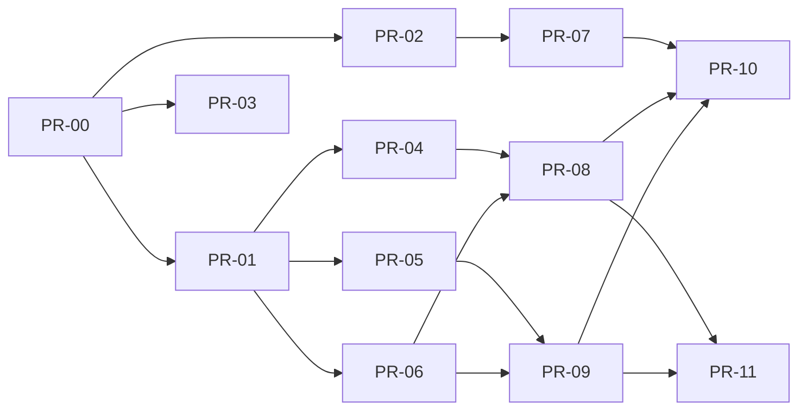

# PR plan: Card controls: freeze/unfreeze and per-category spend limits

Lane L, PR budget 12 (excluding PR-00): **11 PRs** in 4 waves after the skeleton. `max_parallel_coders` = 4.

## Ticket
One GitHub Issue for this feature (requirements §9) must exist **before PR-00 is opened**; the orchestrator creates it
(title "Card controls: freeze/unfreeze and per-category spend limits") and its number `n` gives the key `CL-<n>`.
Every PR title is `CL-<n> PR-NN: <title>` and every PR body starts with `Ticket: CL-<n>` (template
`.github/pull_request_template.md`; enforced by `ci / ticket-key`, pattern `vars.TICKET_KEY_PATTERN`, default `CL-\d+`).
The briefs write the key as the literal placeholder `CL-<n>`; the orchestrator substitutes the real number when it
dispatches each coder and opens each PR.

## Waves
<!-- Wave N may start when every PR in its Depends-on is merged. PRs in the same wave run in
parallel and MUST own disjoint files. PR-00 (skeleton) is always wave 0. -->

| PR | Title | Wave | Depends on | Owns (exact files, comma-separated) | Covers (AC ids) | Tests (ids) | Size |
|----|-------|------|------------|-------------------------------------|-----------------|-------------|------|
| PR-00 | Skeleton & harness scaffolding | 0 | - | (all skeleton files; see *Skeleton contents*) | - | - | L |
| PR-01 | Test harness and domain vocabulary (Money, wire names) | 1 | PR-00 | `src/CardLab.Domain/Money/Money.cs`, `src/CardLab.Domain/Money/MoneyBounds.cs`, `src/CardLab.Domain/Common/WireNames.cs`, `src/CardLab.Domain/Ports/LookupHash.cs`, `tests/CardLab.TestKit/Builders/Builders.cs`, `tests/CardLab.TestKit/Fakes/Fakes.cs`, `tests/CardLab.TestKit/Fakes/InMemoryCardStore.cs`, `tests/CardLab.TestKit/Contracts/CardStoreContractTests.cs`, `tests/CardLab.TestKit/PanScanner.cs`, `tests/CardLab.Domain.Tests/Money/MoneyTests.cs`, `tests/CardLab.Domain.Tests/Money/MoneyBoundsTests.cs`, `tests/CardLab.Domain.Tests/Common/WireNamesTests.cs`, `tests/CardLab.Domain.Tests/Harness/HarnessTests.cs`, `tests/CardLab.Domain.Tests/Fakes/InMemoryCardStoreContractTests.cs` | AC-9 | T-U-22, T-U-23, T-U-7, T-U-32, T-U-33, T-U-24, T-U-25, T-U-21 | L |
| PR-02 | Web foundation: tokens, primitives, formatters, API clients, card list | 1 | PR-00 | `web/src/styles/tokens.css`, `web/src/styles/global.css`, `web/src/components/Button.tsx`, `web/src/components/Button.module.css`, `web/src/components/Field.tsx`, `web/src/components/Field.module.css`, `web/src/components/DataTable.tsx`, `web/src/components/DataTable.module.css`, `web/src/components/Badge.tsx`, `web/src/components/Badge.module.css`, `web/src/components/Notice.tsx`, `web/src/components/Notice.module.css`, `web/src/components/AppShell.tsx`, `web/src/components/AppShell.module.css`, `web/src/components/components.test.tsx`, `web/src/format/money.ts`, `web/src/format/money.test.ts`, `web/src/format/time.ts`, `web/src/format/time.test.ts`, `web/src/format/labels.ts`, `web/src/format/labels.test.ts`, `web/src/api/httpApiClient.ts`, `web/src/api/httpApiClient.test.ts`, `web/src/api/fakeApiClient.ts`, `web/src/test/render.tsx`, `web/src/pages/CardListPage.tsx`, `web/src/pages/CardListPage.module.css`, `web/src/pages/CardListPage.test.tsx` | AC-38 | T-W-1, T-W-2, T-W-4, T-W-5, T-W-6, T-W-7 | L |
| PR-03 | Azure infrastructure and deploy workflow (OIDC, Bicep, smoke) | 1 | PR-00 | `infra/main.bicep`, `infra/demo.bicepparam`, `.github/workflows/deploy.yml`, `docs/ops/azure-setup.md` | AC-27, AC-28, AC-29, AC-34 | T-C-2, T-C-3, T-C-4 | M |
| PR-04 | Domain decision core: periods, validation, decider, properties | 2 | PR-01 | `src/CardLab.Domain/Periods/PeriodCalendar.cs`, `src/CardLab.Domain/Authorisation/AuthorisationRequest.cs`, `src/CardLab.Domain/Authorisation/ValidatedAuthorisation.cs`, `src/CardLab.Domain/Authorisation/TransactionRules.cs`, `src/CardLab.Domain/Authorisation/AuthorisationDecider.cs`, `tests/CardLab.Domain.Tests/Periods/PeriodCalendarTests.cs`, `tests/CardLab.Domain.Tests/Authorisation/DeciderTests.cs`, `tests/CardLab.Domain.Tests/Authorisation/TransactionRulesTests.cs`, `tests/CardLab.Domain.Tests/Generators/CardLabArbitraries.cs`, `tests/CardLab.Domain.Tests/Properties/LimitProperties.cs`, `tests/CardLab.Domain.Tests/Properties/PeriodProperties.cs` | AC-10, AC-11, AC-12, AC-13, AC-14, AC-15, AC-16, AC-17, AC-18, AC-20, AC-25, AC-30 | T-U-11, T-U-12, T-U-13, T-U-27, T-U-8, T-U-9, T-U-10, T-U-14, T-U-15, T-U-16, T-U-18, T-U-26, T-U-17, T-U-28, T-U-29, T-U-30, T-U-31, T-P-4, T-P-5, T-P-1, T-P-2, T-P-3 | L |
| PR-05 | Card controls: freeze, unfreeze and limit changes with audit | 2 | PR-01 | `src/CardLab.Domain/Controls/CardControls.cs`, `src/CardLab.Domain/Application/CardControlsService.cs`, `tests/CardLab.Domain.Tests/Controls/FreezeTests.cs`, `tests/CardLab.Domain.Tests/Controls/LimitTests.cs`, `tests/CardLab.Domain.Tests/Application/CardControlsServiceTests.cs` | AC-1, AC-2, AC-3, AC-6, AC-7, AC-8, AC-9, AC-40 | T-U-1, T-U-2, T-U-3, T-U-20, T-U-4, T-U-5, T-U-6, T-U-34, T-U-35, T-U-36, T-U-37, T-U-38, T-U-39 | M |
| PR-06 | SQL store, schema, seed and integration harness | 2 | PR-01 | `src/CardLab.Infrastructure/Model/Entities.cs`, `src/CardLab.Infrastructure/Model/CardLabDbContext.cs`, `src/CardLab.Infrastructure/Migrations/20261105000000_InitialCardControls.cs`, `src/CardLab.Infrastructure/Migrations/20261105000000_InitialCardControls.Designer.cs`, `src/CardLab.Infrastructure/Migrations/CardLabDbContextModelSnapshot.cs`, `src/CardLab.Infrastructure/Sql/SqlCardStore.cs`, `src/CardLab.Infrastructure/Sql/SqlCardWriter.cs`, `src/CardLab.Infrastructure/Sql/DatabaseSetup.cs`, `src/CardLab.Infrastructure/Lookup/HmacCardNumberLookup.cs`, `src/CardLab.Infrastructure/Time/SystemClock.cs`, `src/CardLab.Infrastructure/Identity/SeededAdminActor.cs`, `tests/CardLab.Integration.Tests/Harness/SqlTestDatabase.cs`, `tests/CardLab.Integration.Tests/Harness/ApiFactory.cs`, `tests/CardLab.Integration.Tests/Harness/InMemoryLogExporter.cs`, `tests/CardLab.Integration.Tests/Store/SqlCardStoreContractTests.cs`, `tests/CardLab.Integration.Tests/Store/SqlCardStoreLockTests.cs`, `tests/CardLab.Integration.Tests/Seed/SeederTests.cs`, `tests/CardLab.Integration.Tests/Lookup/HmacCardNumberLookupTests.cs` | AC-21 | T-I-16, T-I-17, T-I-13, T-I-12 | L |
| PR-07 | Card detail page: status, limits, audit, simulate, transactions | 2 | PR-02 | `web/src/pages/CardDetailPage.tsx`, `web/src/pages/CardDetailPage.module.css`, `web/src/pages/cardDetail/sections.tsx`, `web/src/pages/CardDetail.test.tsx` | AC-22, AC-23, AC-38 | T-W-3, T-W-8, T-W-9, T-W-10 | M |
| PR-08 | Authorisation service and endpoints (processor and simulate) | 3 | PR-04, PR-06 | `src/CardLab.Domain/Application/AuthorisationService.cs`, `src/CardLab.Api/Endpoints/AuthorisationEndpoints.cs`, `tests/CardLab.Domain.Tests/Application/AuthorisationServiceTests.cs`, `tests/CardLab.Integration.Tests/Api/AuthorisationEndpointTests.cs`, `tests/CardLab.Integration.Tests/Api/SimulatePurchaseEndpointTests.cs`, `tests/CardLab.Integration.Tests/Store/ConcurrencyTests.cs`, `tests/CardLab.Integration.Tests/Performance/DecisionLatencyTests.cs` | AC-4, AC-5, AC-10, AC-11, AC-12, AC-19, AC-20, AC-21, AC-32, AC-33, AC-35 | T-U-19, T-U-40, T-U-41, T-U-42, T-U-43, T-U-44, T-U-45, T-U-46, T-I-2, T-I-4, T-I-5, T-I-9, T-I-18, T-I-6, T-I-14 | L |
| PR-09 | Admin API: card endpoints, health, test reset, security headers | 3 | PR-05, PR-06 | `src/CardLab.Api/Endpoints/CardEndpoints.cs`, `src/CardLab.Api/Endpoints/HealthEndpoints.cs`, `src/CardLab.Api/Middleware/SecurityHeaders.cs`, `src/CardLab.Infrastructure/Sql/DatabaseProbe.cs`, `tests/CardLab.Integration.Tests/Api/CardControlsEndpointTests.cs`, `tests/CardLab.Integration.Tests/Api/LimitEndpointTests.cs`, `tests/CardLab.Integration.Tests/Api/CardReadEndpointTests.cs`, `tests/CardLab.Integration.Tests/Api/HealthTests.cs`, `tests/CardLab.Integration.Tests/Api/TestEndpointsTests.cs`, `tests/CardLab.Integration.Tests/Api/SecurityHeadersTests.cs`, `tests/CardLab.Integration.Tests/Api/ErrorMappingTests.cs` | AC-1, AC-2, AC-3, AC-6, AC-7, AC-8, AC-9, AC-34, AC-40 | T-I-19, T-I-1, T-I-3, T-I-10, T-I-15, T-I-20, T-I-21 | M |
| PR-10 | End-to-end journeys, accessibility checks and CI e2e + ZAP | 4 | PR-07, PR-08, PR-09 | `.github/workflows/ci.yml`, `.zap/rules.tsv`, `tests/e2e/playwright.config.ts`, `tests/e2e/src/api.ts`, `tests/e2e/src/a11y.ts`, `tests/e2e/src/panScanner.ts`, `tests/e2e/src/pages/CardListPage.ts`, `tests/e2e/src/pages/CardDetailPage.ts`, `tests/e2e/src/freeze.spec.ts`, `tests/e2e/src/limits.spec.ts`, `tests/e2e/src/simulate.spec.ts`, `tests/e2e/src/privacy.spec.ts`, `tests/e2e/src/a11y.spec.ts`, `tests/e2e/src/formatting.spec.ts`, `tests/e2e/src/smoke/j1.spec.ts` | AC-1, AC-3, AC-4, AC-5, AC-22, AC-23, AC-24, AC-26, AC-36, AC-37, AC-38 | T-E-1, T-E-2, T-E-3, T-E-6, T-E-4, T-E-5, T-E-7, T-C-1 | L |
| PR-11 | Cross-path integration checks: limit changes, privacy, log events | 4 | PR-08, PR-09 | `tests/CardLab.Integration.Tests/Api/LimitChangeThenAuthoriseTests.cs`, `tests/CardLab.Integration.Tests/Privacy/NoPanTests.cs`, `tests/CardLab.Integration.Tests/Logging/EventTests.cs` | AC-24, AC-30, AC-31, AC-39 | T-I-8, T-I-11, T-I-7 | S |

## Dependency graph

| Wave | PRs | Parallel coders |
|---|---|---|
| 1 | PR-01 harness + vocabulary, PR-02 web foundation, PR-03 deploy | 3 |
| 2 | PR-04 decision core, PR-05 card controls, PR-06 SQL store, PR-07 card detail UI | 4 |
| 3 | PR-08 authorisation, PR-09 admin API | 2 |
| 4 | PR-10 E2E + CI e2e/ZAP, PR-11 cross-path checks | 2 |

## Critical path & parallelism
- Critical path: PR-00 → PR-01 → PR-06 → PR-08 / PR-09 → PR-10 (4 waves after the skeleton).
- Max parallel coders: 4 (wave 2), equal to `max_parallel_coders`.
- Why these boundaries: the harness and the shared vocabulary (`Money`, `WireNames`) come first because every backend PR
  tests against them; the pure decision core (PR-04), the control rules + service (PR-05) and the SQL adapter (PR-06)
  are independent once the contract suite exists; the two HTTP PRs split along the two services (authorisation vs admin)
  so they can run in parallel, with `SqlTestDatabase` arrange helpers removing PR-08's need for PR-09's endpoints; web
  runs as its own lane (PR-02 → PR-07) on `FakeApiClient`; infra/deploy (PR-03) has no code dependency.
- Budget: 11 of 12. PR-11 (test-only, size S) is kept separate from PR-10 because it needs only PR-08 + PR-09, is
  .NET-only, and PR-10 is already the largest review (Playwright suite + CI/ZAP); merging them would not shorten the path.

## Skeleton contents (PR-00)
Complete in PR-00 (no later PR edits them): `CardLab.sln`, `global.json`, `Directory.Build.props`,
`Directory.Packages.props` (exact pins, DEC-2), `.editorconfig`, `.gitattributes`, `.gitignore`,
`.config/dotnet-tools.json` (dotnet-ef), all `*.csproj`, `src/CardLab.Api/Program.cs`, `appsettings*.json`,
`Properties/launchSettings.json`, `src/CardLab.Api/Contracts/WireContracts.cs`,
`src/CardLab.Infrastructure/DependencyInjection.cs`, `Options/CardLabOptions.cs`, `Logging/Telemetry.cs`, all domain
records/enums/interfaces (`Common/Result.cs`, `Common/Ids.cs`, `Cards/CardModels.cs`, `Controls/ControlTypes.cs`,
`Limits/*.cs`, `Periods/Period.cs`, `Periods/PeriodRange.cs`, `Authorisation/Outcome.cs`, `Authorisation/Decision.cs`,
`Ports/Ports.cs`, `Ports/ICardStore.cs`, `Application/ApplicationTypes.cs`, `Application/CardLabEvents.cs`),
`tests/CardLab.TestKit/Seed.cs`, `tests/CardLab.Integration.Tests/Harness/ApiClient.cs`, `Harness/SqlCollection.cs`,
`web/` config (`package.json`, lock file, `tsconfig.json`, `vite.config.ts`, `eslint.config.js`, Prettier files,
`index.html`), `web/src/main.tsx`, `App.tsx`, `notImplemented.ts`, `api/types.ts`, `api/apiClient.ts`,
`api/ApiContext.tsx`, `test/setup.ts`, `tests/e2e/` config (`package.json`, lock file, `tsconfig.json`,
`eslint.config.js`, Prettier files), `tests/e2e/src/seed.ts`, `tests/e2e/src/notImplemented.ts`,
`.github/workflows/codeql.yml`, `.github/pull_request_template.md`.
Stubs (`NotImplementedException("PR-NN")` / `notImplemented('PR-NN')`) and test stubs (`[Fact(Skip = "todo")]`,
`[Property(Skip = "todo")]`, `test.todo`, `test.fixme` for Playwright) exist for every owned file in the table above.
Skeleton gate: build `-warnaserror` 0 warnings; 61 domain + 41 integration tests skipped, 15 web todo, 8 e2e fixme;
`dotnet format`, ESLint, Prettier, `tsc` clean; `dotnet publish` copies `web/dist` into `wwwroot`.

## Shared files
Fully written in PR-00 so later PRs never touch them: route registration (`MapCardEndpoints`,
`MapAuthorisationEndpoints`, `MapHealthEndpoint`, `MapTestEndpoints` route tables are complete inside their files;
only the handler bodies are owned), DI wiring (`DependencyInjection.cs`), host pipeline (`Program.cs`), OpenTelemetry
wiring (`Telemetry.cs`), log event definitions (`CardLabEvents.cs`), wire DTOs (`WireContracts.cs`), the typed
integration `ApiClient`, the SPA's `types.ts` / `apiClient.ts` / `ApiContext.tsx` / routes, seed constants (C#, TS and
`appsettings.json`), package pins and lock files, test project settings (global `using Xunit`). Request-pipeline stubs
that run on every request (`UseSecurityHeaders`, `CardLabExceptionHandler`) are pass-through in the skeleton rather than
throwing, so parallel PRs have a working host (PLANNER-DECISION).

## Risks for coding
- **SQL Server for integration tests:** LocalDB (`SqlLocalDB.exe` 170) locally, mssql 2022 container in CI;
  `CARDLAB_TEST_CONNECTION` overrides. PR-06 must keep per-class databases isolated and dropped.
- **xunit v3 / FsCheck skew:** pinned xunit.v3 3.2.2 with FsCheck.Xunit.v3 3.3.4 (3.4+ requires xunit v3 4.x); do not
  upgrade one without the other.
- **Transitive vulnerability:** `System.Security.Cryptography.Pkcs` pinned to 10.0.14 via central transitive pinning
  (Microsoft.Data.SqlClient 6.1.7 pulls 9.0.11, flagged high severity; `-warnaserror` turns NU1903 into a build error).
- **ESLint 9 is marked deprecated** upstream; kept because `eslint-plugin-jsx-a11y` 6.10.2 does not declare ESLint 10.
- **Migration file names** are fixed (`20261105000000_InitialCardControls*`) so PR-06's scope check passes; the coder
  renames the generated files.
- **DST arithmetic** (PR-04): property tests must bias generators to the 2026 change instants or they prove little.
- **Lookup key on demo** (PR-03): a Bicep app-settings block would wipe the human-set key; the brief prescribes merge
  semantics via `az webapp config appsettings set`.
- **PR-10 depends on the UI's accessible names** (labels and button names listed in its brief); renaming them in PR-07
  breaks the page objects.
