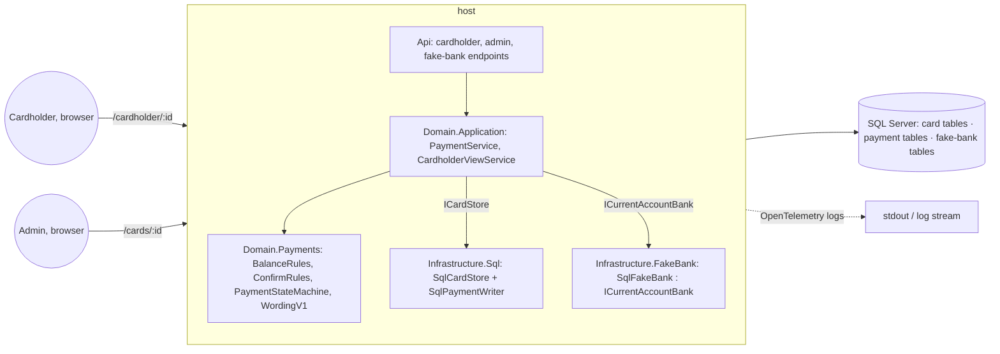

# Full balance payment (CL-3, slice 1): Technical design

## 1. Summary
We add a payments area to the existing modular monolith: a pure `CardLab.Domain.Payments` module
(balance, quote, confirm rules, state machine, wording v1), a new outbound port
`ICurrentAccountBank` with one adapter (the persisted fake bank, shipped to every environment with
its steering control), payment tables in the same SQL database behind the existing `ICardStore`
unit of work, cardholder endpoints under `/api/cardholder`, and a cardholder area in the existing
SPA (view, review, receipt) plus a payment-record page for the admin. The main trade-off: the bank
is called **outside** the 5 s per-card lock, in a three-step flow (reserve pending → call bank →
settle) whose middle step can fail without ever leaving the two sides disagreeing; the pending
state guards the card between the steps and the by-reference status query is the recovery path.
No new hosted service, no new NuGet or npm dependency is expected.

## 2. Engineering context
- **Horizon (from requirements):** long-lived practice product; the balance, payment and port
  models are the foundation for slices 2-4.
- **Complexity budget:** invest-in-boundaries, inherited from 001 (ADR-001, ADR-005): explicit
  ports with fakes and a shared contract suite, a pure domain with property tests, one host and one
  database. Everything below is held to "one more module per concern, no new infrastructure".
- **Team & skills:** one maintainer (CODEOWNERS), C#/.NET and React/TypeScript, SDLC agents write
  the code; the stack is fixed, appetite for new tech is nil in this slice (NFR-6).
- **Environments:** local (LocalDB), CI (mssql 2022 container), `demo` (App Service F1 + Azure SQL
  free offer, deployed from `main`). No staging.
- **Volumes (now → 12 mo):** three seeded cards, tens of payments per day in demos; the payment
  tables stay in the thousands of rows. Nothing here needs tuning beyond two indexes.
- **Hard constraints / bans:** money code only under `src/CardLab.Domain` (tier 3 review, property
  tests, NFR-1); no PAN or full account number anywhere (NFR-3); no new Azure resources (NFR-6);
  wording v1 verbatim (NFR-7, CD-2..CD-4); records never deleted by a product path (CD-5, CD-8);
  public repo: fictional data only; PR titles and bodies carry `CL-3`.

## 3. Decisions

### DEC-1 Decisions inherited from the requirements phase (human, 2026-11-07, via relay)
Recorded here so the design never re-opens them; each is traced to the element that implements it.

| Decided | Where it lands in this design |
|---|---|
| Balance owed = approved purchases − completed payments, floored at £0.00, computed from records (req. decision 8) | `BalanceRules.Owed`, two `SUM`s inside the card lock (§5, §8) |
| Balance changed between review and confirm → refuse and re-quote (decision 10) | `ConfirmRules.Decide` → `RefuseBalanceChanged` (§5, §8 flow 3) |
| Bank timeout → pending; *Check status* + automatic check on cardholder view / admin card detail open; one payment in flight per card; a pending payment is never re-sent (decisions 11, 29 / CD-6) | pending state, `CheckStatusAsync`, SPA auto-check on load, filtered unique index on pending (§6, §8 flow 2) |
| Every seeded card has a no-login cardholder view; actor = that card's cardholder (decision 9) | `/cardholder/:id` routes, actor derived from the card (DEC-9, §7) |
| Visible one-shot *Fake bank: next outcome* control in every environment incl. `demo`, off the review screen and receipt; steered outcomes marked simulated (decisions 12, 15, 23) | `FakeBankSteering`, `/api/fake-bank`, `Simulated` flag on bank results (§5, §6, §7) |
| Payment rows in the card's history and the current account's recent activity (last 10) on the cardholder view (decisions 14, 19) | `ListActivityAsync`, `ICurrentAccountBank.ListRecentEntriesAsync` (§5, §7) |
| Standing authority per cardholder, named on each record (decision 27) | `LinkedAccount.AuthorityBasis` copied onto every quote (§6) |
| No fee from anyone; "£0.00 (no fee)" (decision 28) | `Fee = Money.Zero` on every quote; W-1 rendered server-side (DEC-13) |
| Record = structured fields + verbatim wording + version id; retention 6 years from the final state / refusal; no product path deletes (CD-4, CD-5, CD-8) | `PaymentQuote` immutable columns, `PaymentEvent` append-only, no delete code paths (§6) |
| No `AuditEvent` rows for payments (decision 18) | payments never call `AppendAudit`; `PaymentStateChanged` log event instead (§12) |
| Never call the bank inside the per-card lock (planner hint, human-flagged risk) | DEC-3 |

**Chosen:** as listed (by the human during requirements). **We give up:** nothing new; these
constrain the options below. **Revisit if:** a later slice changes the requirement.

### DEC-2 Complexity budget and layout for this slice
| Criterion | A: same three projects, new folders (`Domain/Payments`, `Infrastructure/Payments`, `Infrastructure/FakeBank`) | B: new `CardLab.Payments` + `CardLab.FakeBank` projects | C: payments as a separate service/process |
|---|---|---|---|
| Fits requirements | yes (NFR-1: money code stays under `CardLab.Domain`) | yes | no (NFR-6: no new hosted services) |
| Code we write | least (no csproj, DI or CI changes) | + 2 csproj, DI wiring, CI matrix | + deployment, messaging |
| Test effort & harness | reuses `CardLab.TestKit`, `ApiFactory`, `SqlTestDatabase` as is | same harness, more project references | new harness |
| Complexity | low | medium (project graph) | high |
| Maintainability | folder boundaries enforced by review (as 001 does for money code) | compile-time boundaries | isolation |
| Run cost | £0 | £0 | > £0 |
| Lock-in | none | none | none |
| Time to ship | shortest | + ~half a day | weeks |
| Team familiarity | 001 layout | 001 layout | none |

**Chosen:** A. Folders, not projects; the fake bank lives in `CardLab.Infrastructure.FakeBank`
with its own tables and never joins card tables (reviewer-enforced, like "money code only in
Domain"). **We give up:** compile-time enforcement of the fake-bank boundary. **Revisit if:** a
real bank adapter arrives (then the fake moves to a test/demo project).

### DEC-3 Payment flow: where the bank call sits relative to the per-card lock (Q-1, human, round 1)
| Criterion | A: three steps, lock only around local steps (Recommended) | B: hold the card lock across the bank call | C: outbox + background worker calls the bank |
|---|---|---|---|
| Fits requirements | R-6..R-11, NFR-2; pending is the guard between steps (R-8) | breaks ADR-002: purchases on the card wait up to 10 s and hit the 5 s lock timeout (503) | fits, but the cardholder waits for a poll cycle; NFR-2 (3 s receipt) needs a tight loop |
| Code we write | one service with two short locked sections and one unlocked call | least | service + `IHostedService` + polling + leader concerns |
| Test effort & harness | unit with `FakeBank` scripting outcomes; crash-between-steps test is a unit test (throw after step 2) | simple | timing-dependent tests |
| Complexity | medium (two transactions, explicit recovery path) | low | high |
| Maintainability | clear invariants; recovery = status check (already required) | none to maintain, but wrong | worker on F1 without Always On sleeps |
| Run cost | £0 | £0 | £0 but unreliable on F1 |
| Lock-in | none | none | none |
| Time to ship | days | hours | +days |
| Team familiarity | pattern from 001 (lock) + pending state | 001 | new |

**Chosen:** A. Step 1 (locked): validate the reference, compare balance to the quote,
check no pending payment, insert `Payment(Pending)` + `confirm_created` event, commit. Step 2
(unlocked): `RequestDebitAsync` with the 10 s budget. Step 3 (locked): settle to
`Completed`/`Failed` with balance before/after, or on no answer leave `Pending` and record
`bank_unanswered`. A crash anywhere after step 1 leaves a pending payment that the status check
settles by reference. **We give up:** the single-transaction simplicity of B; two round trips to
the database per confirm. **Revisit if:** a real bank adapter offers webhooks (then step 3 is also
driven by a callback). **ADR:** ../../kb/decisions/ADR-006-payment-three-step-flow.md

### DEC-4 Persistence seam for payments (Q-2, human, round 1)
| Criterion | A: same `ICardStore` unit of work; payments through `ICardWriter.Payments : IPaymentWriter`; reads on `ICardStore` (Recommended) | B: flat extension of `ICardWriter`/`ICardStore` with ~10 new methods | C: separate `IPaymentStore` with its own lock and transaction |
|---|---|---|---|
| Fits requirements | one lock, one transaction: reference check, balance and pending insert are atomic (R-5, R-7, R-8, R-9) | same | atomicity across two stores needs a shared transaction → leaks EF into the domain |
| Code we write | new interface + fake + SQL writer + contract class; 001 interfaces untouched | edits to 001 interfaces, fake and SQL writer | two stores, two fakes, coordination code |
| Test effort & harness | `PaymentStoreContractTests` sibling of `CardStoreContractTests`, run vs in-memory and SQL | contract suite grows in place | two contract suites + a cross-store test |
| Complexity | low (one more interface) | low | medium |
| Maintainability | payment surface in its own file; parallel coders don't collide on 001 files | merge conflicts on `ICardWriter` | duplicate locking |
| Run cost | £0 | £0 | £0 |
| Lock-in | none | none | none |
| Time to ship | same as B | same | longer |
| Team familiarity | 001 pattern | 001 pattern | new |

**Chosen:** A. **We give up:** a store boundary per aggregate; payments and purchases
share one unit of work (which is what the balance needs anyway). **Revisit if:** payments ever
need a different consistency scope than the card.

### DEC-5 Two confirms of one reference at the same instant (Q-3, human, round 1)
| Criterion | A: the second caller joins the in-flight bank call and gets the same receipt (Recommended) | B: the second caller gets the current state immediately (pending) | C: the second caller polls the database until the first settles |
|---|---|---|---|
| Fits requirements | AC-10 "both callers receive the same outcome" literally | AC-9 yes; AC-10 only if "pending vs completed" counts as the same outcome (it does not) | AC-10 yes |
| Code we write | an in-process `InFlightPayments` registry (`ConcurrentDictionary<reference, Task<Receipt>>`) | none | a polling loop with a deadline |
| Test effort & harness | one unit test with a gated `FakeBank` (two awaiters, one bank call) | trivial | timing-sensitive |
| Complexity | low; relies on the single-host deployment (ADR-001), which the status check covers if a confirm arrives after a restart | lowest | medium |
| Maintainability | registry is 30 lines, cleared on completion | — | — |
| Run cost | £0 | £0 | DB polling |
| Lock-in | single instance (already the case) | none | none |
| Time to ship | hours | none | hours |
| Team familiarity | standard | — | — |

**Chosen:** A. The second confirm still takes the card lock, records a
`confirm_repeated` event, then awaits the registry task if present, else returns the stored
receipt. **We give up:** correctness of the "same outcome" guarantee across two hosts (we have
one). **Revisit if:** the app scales out (then C, or a bank callback).
**Erratum (BUG-003, human, 2026-11-07):** a status check of a reference whose confirm is in flight on
this host awaits that confirm first and never asks the bank while the debit call is open (otherwise
a check could read `NotReceived`, settle `Failed`, and then the debit lands: R-9). The wait is
bounded by the check's own 10 s budget; on expiry the check appends `StatusCheckUnanswered`, stays
`Pending` and returns W-10 without calling the bank.

### DEC-6 Fake bank placement and how it "does not answer" (Q-4, human, round 1)
| Criterion | A: `CardLab.Infrastructure.FakeBank`, own tables in the same database and DbContext; timeout mode = the call never returns and the service's 10 s budget cancels it (Recommended) | B: same placement; timeout mode returns "unknown" at once (no real wait) | C: separate project and DbContext; file- or memory-backed ledger |
|---|---|---|---|
| Fits requirements | R-15 (ledger persists, reset to seed), AC-13 (within 10 s + 2 s), NFR-2 budget exercised for real | R-15 yes; the budget code path is never exercised end to end | memory loses the ledger on restart (AC-22 fails); file storage on App Service is fragile |
| Code we write | 4 tables, one adapter, one steering endpoint | same minus the delay | + project, migrations history, DI |
| Test effort & harness | integration tests set `CardLab:Payments:BankTimeoutSeconds=1` so the wait is 1 s; E2E uses the real 10 s where a scenario needs a pending state (4 waits: T-E-3 twice, T-E-5, T-E-6; PR-08 review F8) | fast but hollow | more fixtures |
| Complexity | low | low | medium |
| Maintainability | one migrations history | one | two |
| Run cost | £0 | £0 | £0 |
| Lock-in | none (the adapter sits behind the port) | none | none |
| Time to ship | days | days | + a day |
| Team familiarity | 001 EF pattern | same | new |

**Chosen:** A. The fake applies the ledger entry *before* hanging in "time out, debit
applied" mode and records nothing in "time out, not received" mode, so AC-14 and AC-15 are both
reachable through the normal status query. **We give up:** a fast timeout path in E2E (one spec
waits 10 s). **Revisit if:** E2E time matters more than realism (flip the config in CI only). **ADR:** ../../kb/decisions/ADR-007-fake-bank-shipped-adapter.md

### DEC-7 Steering the status check (Q-5, human, round 1)
AC-16 needs the *status check* to go unanswered, but R-15's control steers the *next debit
request* only. **Proposed:** the fake-bank panel gets a second one-shot setting, *Next status
check: answers / does not answer* (default answers), same rules: applies once, then reverts; the
unanswered check is recorded as `status_check_unanswered` with `Simulated = true`. **Chosen:** as proposed. **We give up:**
a one-control panel. **Revisit if:** the compliance partner wants the control hidden in `demo`.

### DEC-8 Reference format (Q-6, human, round 1)
`PAY-` followed by 8 Crockford base32 characters (no I, L, O, U), e.g. `PAY-7F3K2QH9`, produced
by a port `IPaymentReferences.Next()` (real: `RandomNumberGenerator`; fake: sequential). 40 bits
of randomness make collisions practically impossible at our volume; the primary key is unique so a
collision becomes an insert failure that returns 503 and is retried by the cardholder (a new
review). **Rejected:** GUID (unreadable on a receipt), sequence (leaks volume, needs a DB
sequence). **Chosen:** `PAY-` + 8 Crockford base32 via `IPaymentReferences`. **We give up:** nothing material.

### DEC-9 Who is the actor on a cardholder action (Q-8, human, round 1)
The cardholder endpoints resolve the card first and record the actor as
`Actor(Kind = Cardholder, Id = cardId, Name = card.CardholderName)`; `ICurrentActor`
(seeded admin) is untouched and still used for admin control changes. **Rejected:** a scoped
`ICurrentActor` that reads the route (an endpoint filter plus an accessor to say what the card
already says). **Chosen:** derive the actor from the card. **We give up:** a single actor abstraction for both areas until real auth arrives,
when the cardholder endpoints gain a policy "actor must be this card's cardholder" and the
derivation moves behind it.

### DEC-10 Wording is rendered by the server (follows from CD-4)
`WordingV1` in `CardLab.Domain.Payments.Wording` renders W-1..W-10 with substitutions; the API
returns the rendered strings; the SPA displays them verbatim; the record stores exactly those
strings with `WordingVersion = "v1"`. So "what was shown" and "what was stored" are the same bytes
by construction. **Rejected:** rendering in the SPA and posting the text back (the record would
trust the client); rendering twice (drift). **Chosen:** server-rendered wording, stored verbatim. **We give up:** client-side formatting flexibility.

### DEC-11 Cardholder UI placement and layout (Q-9, human, round 2)
| Criterion | A: same SPA, three cardholder routes, single-column pages (Recommended) | B: same SPA, review and receipt as inline panels on the card view | C: separate cardholder SPA build |
|---|---|---|---|
| Fits requirements | OB-7/OB-8 "one screen with the action" is literally one page; receipt has a URL to reload (R-12); fake-bank control is on a different page from review/receipt (AC-33) | one screen is a panel among balance, activity and the fake-bank section: AC-33 needs careful hiding; reload loses the receipt | fits |
| Code we write | 3 pages + shell variant, reuse of 5 primitives | 1 page with 3 states, more conditional rendering | second Vite app, routing, deploy of two bundles |
| Test effort & harness | page objects per page; simple | state-machine page object | duplicate harness |
| Complexity | low | medium | high |
| Maintainability | pages map to API calls one-to-one | one big page | two apps |
| Run cost | £0 | £0 | £0 |
| Lock-in | none | none | none |
| Time to ship | ~2 PRs | ~2 PRs | +days |
| Team familiarity | 001 pattern | 001 pattern | new |

**Chosen:** A, with the §4.1 layout: single column max 720 px; balance first, then pending
notice, linked account, two activity tables, fake-bank section last; header shows the cardholder's
name and a "Cardholder view" label; admin card list gets a "Cardholder view" link per card.
**We give up:** the admin's two-column density on cardholder pages (the cardholder has one job).
**Revisit if:** slice 4 adds a history page with filters (then a second column).

### DEC-12 Admin history: new `activity` endpoint (Q-10, human, round 2)
| Criterion | A: new `GET /api/cards/{id}/activity` (purchases + payments merged); `/transactions` unchanged (Recommended) | B: add payment rows to `GET /api/cards/{id}/transactions` with `kind` | C: separate `GET /payments` list only; the admin SPA merges client-side |
|---|---|---|---|
| Fits requirements | R-13 "payment appears in the card's transaction history as a payment"; 001's AC-32/T-I-9 keep their contract | fits, but changes a 001 contract (new rows with null category/merchant); 001 tests asserting counts of `/transactions` break | fits; ordering logic in the SPA (untested by integration) |
| Code we write | one store read (`ListActivityAsync`, already needed for the cardholder view), one endpoint, SPA table swap | DTO change, 001 test updates | SPA merge code |
| Test effort & harness | one integration test; reuse for the cardholder view | re-run 001 suite + fixes | web unit for merging |
| Complexity | low | low | low |
| Maintainability | one ordering rule, server-side | mixed row shapes in one list | duplicated ordering |
| Time to ship | shortest | + 001 fixes | same |

**Chosen:** A. The admin "Transactions" table becomes "Activity" (same columns plus type
and state badges); `/transactions` stays for the processor-facing contract. **We give up:** a
single endpoint for history. **Revisit if:** slice 4's cross-account history replaces both.

### DEC-13 Automatic status check on open is triggered by the SPA (Q-11, human, round 2)
| Criterion | A: GET view is pure; the SPA calls `POST .../check` when the view shows a pending payment, then re-reads (Recommended) | B: the GET itself runs the status check (side effect) | C: a timer in the host checks pending payments every N s |
|---|---|---|---|
| Fits requirements | CD-6 / R-11 / AC-34 (open → settled); one code path for manual and automatic checks | fits; a GET that calls the bank with a 10 s budget makes the view slow to render (NFR-2 2 s) when the bank hangs | fits, but F1 has no Always On; the host sleeps between requests |
| Code we write | ~15 lines in two pages | ~10 lines in the service | hosted service + leader logic |
| Test effort & harness | web unit (fake client records the call) + E2E AC-34 | integration on the GET | timing tests |
| Complexity | low | low | medium |
| Maintainability | HTTP semantics preserved (GET idempotent, cacheable, no bank call) | surprising GET | background work on a sleepy host |
| Time to ship | hours | hours | days |

**Chosen:** A. The admin card detail does the same when it sees a pending payment in
the activity list. **We give up:** a slightly longer open sequence (two requests) when a payment is
pending. **Revisit if:** a real bank adapter offers callbacks (then no check on open is needed).

### DEC-14 Deploy smoke includes one payment journey on `demo`, its records marked (Q-12, human, round 2)
**Proposed:** add `smoke/pay.spec.ts`: simulate one purchase on "Ops van", open the cardholder
view, pay the full balance with the bank left at *complete*, assert W-2 and the ≤ 3 s receipt
(AC-26, G-1); the end state (balance £0.00, one more payment row) is a valid demo state. Cost: a few
seconds of the daily F1 quota per deploy. **Rejected:** measuring NFR-2 only CI-local (the
requirement says warm on `demo`); a smoke that also exercises timeout (10 s of quota per deploy, and
it leaves a pending payment on the demo). **Chosen:** yes, with the records marked as smoke
(human's condition: no product path deletes records and retention is 6 years, so every deploy adds a
permanent payment and compliance record on `demo` that no person made; it must never be mistaken
for real use). Marking (DEC-15): the smoke steers the fake bank to *complete* explicitly, so the
bank outcome carries `Simulated = true`, and it sends the request header
`X-CardLab-Origin: deploy-smoke`, stored as `Origin = DeploySmoke` (enum name; wire name `deploy_smoke`) on the quote and shown on the
record page, the admin Payments list and the activity rows as an "origin: smoke" badge.
**We give up:** nothing. **Revisit if:** quota pressure.

### DEC-15 Origin marker on the record (human's condition on Q-12, round 2)
`PaymentQuote.Origin varchar(20)`: enum name `CardholderView` (default) or `DeploySmoke`, like every
other enum column (wire names `cardholder_view` / `deploy_smoke`; erratum BUG-005, 2026-11-07). Set from the
request header `X-CardLab-Origin` on `POST .../quotes` only when its value is exactly
`deploy-smoke`; any other value or absence → `cardholder_view` (no free text is stored). Copied into
`Receipt`, `PaymentRecord`, the Payments list and `ActivityEntry` so every surface can label it.
**Rejected:** inferring "smoke" from the simulated flag alone (a demo visitor steering the bank is
also simulated, but is a person); a separate smoke-only endpoint (duplicates the journey the smoke
is meant to prove); deleting smoke records after the run (violates CD-5/CD-8). **Chosen:** the
`Origin` column set from the header literal. **We give up:** an unauthenticated client can mark its
own payment as a smoke payment; harmless in a lab (it can only under-claim real use, never hide a
record). **Requirements note (for the gate):** R-14 and §8 list the record's fields; `Origin` is an
additive field not listed there. Flagged in the gate round so the human can decide between a
one-line decisions-log erratum and a requirements amendment.

## 4. Architecture

- **Domain** (`src/CardLab.Domain/Payments/`): pure rules and wording; no I/O. Application
  services `PaymentService` (quote, confirm, check status) and `CardholderViewService` (the
  aggregate read) orchestrate ports.
- **Ports**: `ICardStore` (+ `IPaymentWriter`, DEC-4), `ICurrentAccountBank` (new),
  `IPaymentReferences` (new), `IClock` (existing).
- **Infrastructure**: `SqlPaymentWriter` inside `SqlCardStore.WithCardLockAsync`;
  `SqlFakeBank` (ledger, requests, steering) in `Infrastructure/FakeBank/`; migration
  `AddPayments`; `Seeder` gains the linked account and the bank account.
- **Api**: `MapCardholderEndpoints` (`/api/cardholder/...`), `MapFakeBankEndpoints`
  (`/api/fake-bank`), additions to `MapCardEndpoints` (balance, activity, payment records);
  `TestDataReset` extended.
- **Web**: cardholder area (`/cardholder/:id`, `/pay`, `/payments/:reference`), admin additions
  (balance, Payments section, record page), `ApiClient` methods, `FakeApiClient`.

### 4.1 UI/UX design
Run with `sdlc:ui-ux-pro-max` on 2026-11-07 (stack: React 19.2 + TypeScript from `web/package.json`;
existing tokens in `web/src/styles/tokens.css` win over search results). Searches (`--domain ux`):
"bank payment confirmation review screen fintech" (matches: Confirmation Messages, Heading
Hierarchy, Screen Reader, Focusable Error Summary; "Are you sure modal" rejected: 001 bans modals
and OB-7 wants one screen), "transaction receipt status pending success error feedback" (matches:
Submit Feedback, Error Recovery, Error Messages `role=alert`), "form submit double click prevent
duplicate loading" (match: Loading Buttons: disable + loading state during the async action),
"customer account balance summary card page layout banking" (no layout match; general fallback),
`--stack react` "confirmation destructive action button label clear" (matches: label form
controls; `useActionState` noted, not adopted: the pages use the 001 pending-button pattern).

- **Direction / style:** unchanged from 001 DEC-13 (Minimalism & Swiss, Banking palette, Inter,
  CSS Modules, five primitives). No new tokens except two status colours for payment states:
  pending `#92400E` on `#FEF3C7` (contrast 7.4:1), completed reuses approved, failed reuses
  declined.
- **Tokens:** as `tokens.css` (§4.1 of 001) plus `--color-status-pending`,
  `--color-status-pending-bg`.
- **Layout pattern per page (proposed, Q-9):**
  - *Cardholder view* `/cardholder/:id`: app shell header shows "CardLab", the business name and
    the **cardholder's** name (not the admin's), with a "Cardholder view" label. Single column,
    max-width 720 px: heading (card name, "•••• 0001"); **Balance** section (figure in 32 px
    tabular numerals, then either the primary button *Pay full balance* or the W-7/W-8/W-9 text,
    and for W-9 a *Check status* button); **Pending payment** notice (W-5 + *Check status*) when
    one exists; **Linked current account** (display name, "ending 7731", available balance,
    authority sentence); **Recent card activity** table (date, description, amount, type badge
    purchase/payment, state badge); **Current account recent activity** table (date, reference,
    amount); last, a visually separated **Fake bank** section (`<section aria-labelledby>` with
    heading "Fake bank (simulation control)", two labelled selects and a *Set* button, text
    showing the current setting).
  - *Review* `/cardholder/:id/pay`: one screen. Heading W-1; a `<dl>` with the W-1 lines in
    order (Amount, Fee, Total to pay, When, From, To); the primary button "Confirm payment of
    {amount}" (pending state while confirming, `aria-disabled` + guard as 001 BUG-010); a *Back*
    link. Nothing else (no fake-bank control, no activity).
  - *Receipt* `/cardholder/:id/payments/:reference`: heading by state ("Payment complete" /
    "Payment not made" / "Payment pending"), the W-2..W-5/W-10 message in a `Notice`
    (`role="status"`), a `<dl>` (Reference, Amount, Fee, Time, From, To, Outcome badge), *Check
    status* button when pending, link *Back to your card*.
  - *Admin card detail* `/cards/:id`: heading gains "Balance owed £x" ; the Transactions table
    becomes **Activity** (purchases and payments; payments carry a type badge and a state badge and
    link to the record); new **Payments** section listing every reference (incl. refused) newest
    first, each with origin (DEC-15) and state badges.
  - *Admin payment record* `/cards/:id/payments/:reference`: read-only page: "What the cardholder
    saw" (verbatim lines, version), acceptance (time, actor, authority), payment (state, amounts,
    balances before/after, effective time, simulated flag, origin), events table (time, kind, from → to,
    detail).
- **Design-system file:** not persisted (001 DEC-17).

| Rule (checkable) | Source | Traced to | Checked by |
|---|---|---|---|
| Text contrast ≥ 4.5:1; non-text ≥ 3:1 (incl. the new pending badge) | 001 rule, style match | NFR-5, AC-28 | E2E axe (T-E-5) |
| Whole journey (view → review → confirm → receipt → check status) operable by keyboard; focus ring visible | ux priority 1 | NFR-5, AC-28 | E2E keyboard (T-E-5) |
| Confirm button shows a pending state and ignores further clicks while the confirm is in flight (`aria-disabled` + guard, focus stays) | ux match "Loading Buttons", 001 BUG-010 | AC-9, AC-10 | web unit (T-W-3), E2E (T-E-1) |
| Review screen contains the W-1 lines and the confirm button in one `<main>` with no link, tab or further step between them; fake-bank control absent | OB-7/OB-8 (AC-6), ux "Heading Hierarchy" | AC-6, AC-33 | E2E text + DOM assertions (T-E-1, T-E-4) |
| Outcome messages are the server strings verbatim, rendered in a `Notice` with `role="status"` (pending/completed) or `role="alert"` (failed/refused) | ux match "Error Messages", DEC-10 | AC-7, AC-8, AC-11..AC-13, AC-16, AC-35 | E2E text assertions, web unit |
| Payment state shown as a text badge, never colour alone | 001 rule "Color Only" | AC-2, AC-13 | E2E, axe |
| Every failed or refused outcome names the next step (W-3, W-4, W-6, W-9, W-10 do) and offers the matching control (*Check status*, *Back*) | ux match "Error Recovery" | AC-11, AC-12, AC-16 | E2E |
| Amounts `£1,234.56`; times Europe/London `25 Oct 2026 00:30`; W-* substitutions use the same formatter | 001 rule | R-12, AC-7 | web unit (T-W-1), E2E |
| Fake-bank section has a heading containing "Fake bank" and is last in the DOM order; never rendered on review or receipt | CQ-8 / decision 23 | AC-33 | E2E (T-E-4), web unit |
| Tables in `overflow-x: auto`; no page scroll at 1024-1440 px; cardholder pages also usable at 768 px (single column) | ux "Breakpoint Testing" | NFR-5 | E2E viewport check |
| `prefers-reduced-motion` respected; buttons ≥ 44 px tall, ≥ 8 px apart; semantic HTML; no modals; no icons | 001 rules | NFR-5 | review + axe |

**Anti-patterns to avoid:** a confirmation modal (one screen, not a dialog); revealing the fee or
execution time only on the receipt; a spinner-only pending state without text; colour-only payment
state; disabling the confirm button natively (focus loss); client-side wording.

## 5. Modules & interfaces (seams)
| Module | Responsibility | Public interface (signatures) | Depends on (ports) |
|--------|----------------|-------------------------------|--------------------|
| `CardLab.Domain.Payments` (types) | payment vocabulary | `enum PaymentState { Pending, Completed, Failed }`; `enum PaymentKind { Full }` (slice 2 adds `Minimum`, `Chosen`); `enum FailureReason { InsufficientFunds, AccountUnavailable, NotReceived }`; `enum QuoteStatus { Open, Confirmed, Refused }`; `enum PayAvailability { Available, NothingToPay, AboveLimit, PaymentPending }`; `readonly record struct PaymentReference(string Value)` (format DEC-8, `TryParse`); `readonly record struct PaymentId(Guid Value)`; `enum ActorKind { Admin, Cardholder }`; `record PaymentActor(ActorKind Kind, Guid Id, string Name)` | none |
| `BalanceRules` | balance arithmetic | `static Money Owed(Money approvedPurchases, Money completedPayments)` (floors at zero); `static PayAvailability Availability(Money owed, bool hasPendingPayment)` (`NothingToPay` if £0.00, `AboveLimit` if > £1,000,000.00, `PaymentPending`, else `Available`) | none |
| `Quote` | the immutable shown-and-accepted part | `record Quote(PaymentReference Reference, CardId Card, PaymentKind Kind, Money Amount, Money Fee, Money Total, string FromLabel, string ToLabel, PaymentActor Actor, string AuthorityBasis, DateTimeOffset CreatedAtUtc, RenderedWording Shown)`; `record RenderedWording(string Version, string Heading, IReadOnlyList<string> Lines, string ButtonLabel)`; `static Quote QuoteRules.Create(PaymentReference, CardRef card, string cardName, LinkedAccount account, Money owed, PaymentActor, DateTimeOffset now)` (Fee = £0.00, Total = Amount, wording via `WordingV1`) | none |
| `ConfirmRules` | exactly-once and one-in-flight | `static ConfirmDecision Decide(Quote quote, QuoteStatus status, PaymentState? paymentForQuote, PendingPaymentRef? otherPending, Money currentOwed)` → `ConfirmDecision` = `Create` \| `Repeat` \| `RefuseBalanceChanged(Money newOwed)` \| `RefuseAlreadyRefused(Money newOwed)` \| `RefusePendingExists(PaymentReference, Money amount)` | none |
| `PaymentStateMachine` | lifecycle | `static Result<Transition, string> Apply(PaymentState current, BankOutcome outcome)`; `record Transition(PaymentState From, PaymentState To, FailureReason? Reason, DateTimeOffset? BankDebitedAtUtc)`; terminal states reject every outcome; `Unknown` leaves `Pending` | none |
| `BankOutcome` | what the bank said | `abstract record BankOutcome(bool Simulated)`: `Completed(DateTimeOffset? DebitedAtUtc)`, `Refused(FailureReason Reason)` (InsufficientFunds/AccountUnavailable), `NotReceived`, `Unknown` (no answer in time) | none |
| `WordingV1` | §17 strings | `const string Version = "v1"`; `static RenderedWording ReviewScreen(Money amount, string fromLabel, string toLabel)` (W-1); `static string Completed(Money amount, Money balance, PaymentReference)` (W-2); `RefusedInsufficientFunds` (W-3), `RefusedAccountUnavailable` (W-4), `Pending` (W-5), `BalanceChanged(Money balance)` (W-6), `NothingToPay` (W-7), `AboveLimit(Money balance)` (W-8), `PendingExists(Money amount, PaymentReference)` (W-9), `StillPending(PaymentReference)` (W-10); `static string Label(string name, string lastFour)` → `"{name}, ending {lastFour}"`; amounts via `Money.ToDisplay()` → `£1,234.56` (new on `Money`) | none |
| `CardLab.Domain.Ports.ICurrentAccountBank` | the external bank | `Task<AccountSnapshot> GetAccountAsync(BankAccountRef, ct)` → `record AccountSnapshot(BankAccountRef Ref, string LastFour, Money AvailableBalance)`; `Task<IReadOnlyList<BankEntry>> ListRecentEntriesAsync(BankAccountRef, int take, ct)` → `record BankEntry(PaymentReference Reference, Money Amount, DateTimeOffset PostedAtUtc, string Narrative)` newest first; `Task<BankOutcome> RequestDebitAsync(DebitRequest, ct)` → `record DebitRequest(BankAccountRef Account, PaymentReference Reference, Money Amount, string Narrative)`; `Task<BankOutcome> GetDebitStatusAsync(BankAccountRef, PaymentReference, ct)`. Contract: a reference the bank has seen is never applied twice; `RequestDebitAsync` may never return (the caller's `ct` is the budget) and then throws `OperationCanceledException`; `GetDebitStatusAsync` answers `Completed`/`Refused`/`NotReceived` or does not return. `readonly record struct BankAccountRef(Guid Value)` | — |
| `IPaymentReferences` | randomness port | `PaymentReference Next()` | — |
| `ICardStore` additions | reads outside the lock | `Task<LinkedAccount?> GetLinkedAccountAsync(ct)` → `record LinkedAccount(Guid Id, string DisplayName, string LastFour, BankAccountRef BankRef, string AuthorityBasis)`; `Task<CardBalance?> GetBalanceAsync(CardId, ct)` → `record CardBalance(Money ApprovedPurchases, Money CompletedPayments, Money Owed)`; `Task<PaymentRecord?> GetPaymentRecordAsync(PaymentReference, ct)`; `Task<IReadOnlyList<PaymentRecord>> ListPaymentRecordsAsync(CardId, ct)` (newest first, incl. refused and open quotes); `Task<IReadOnlyList<ActivityEntry>> ListActivityAsync(CardId, int take, ct)` → `record ActivityEntry(DateTimeOffset At, ActivityKind Kind, Money Amount, string Description, string? Outcome, PaymentReference? Reference)` (ordered newest first by purchases' `DecidedAtUtc` and payments' `CreatedAtUtc`; `At` shown = a purchase's processor timestamp `OccurredAt`, exactly as 001's history (erratum BUG-009, human, 2026-11-07), and a payment's confirm time) | — |
| `ICardWriter.Payments : IPaymentWriter` (inside the lock) | atomic payment writes | `Task<Money> SumApprovedPurchasesAsync(ct)`; `Task<Money> SumCompletedPaymentsAsync(ct)`; `Task<QuoteRecord?> GetQuoteAsync(PaymentReference, ct)` → `record QuoteRecord(Quote Quote, QuoteStatus Status, PaymentSnapshot? Payment)`; `Task<PaymentSnapshot?> GetPendingPaymentAsync(ct)` → `record PaymentSnapshot(PaymentId Id, PaymentReference Reference, PaymentState State, Money Amount, DateTimeOffset CreatedAtUtc, Settlement? Settlement)`; `void AppendQuote(Quote)`; `void SetQuoteStatus(PaymentReference, QuoteStatus, string? refusalReason, Money? balanceAtRefusal, DateTimeOffset at)`; `PaymentId CreatePayment(NewPayment)` (state Pending); `void SettlePayment(PaymentId, Settlement)` → `record Settlement(PaymentState State, FailureReason? Reason, DateTimeOffset SettledAtUtc, DateTimeOffset EffectiveAtUtc, DateTimeOffset? BankDebitedAtUtc, Money BalanceBefore, Money BalanceAfter, bool Simulated)`; `void AppendEvent(PaymentEvent)` → `record PaymentEvent(PaymentReference Reference, PaymentId? Payment, DateTimeOffset AtUtc, PaymentEventKind Kind, PaymentState? From, PaymentState? To, string? Detail, bool Simulated)`; `enum PaymentEventKind { ConfirmCreated, ConfirmRepeated, ConfirmRefused, DebitRequested, BankCompleted, BankRefused, BankUnanswered, StatusCheckCompleted, StatusCheckRefused, StatusCheckNotReceived, StatusCheckUnanswered }` | — |
| `PaymentRecord` | the full record (AC-20) | `record PaymentRecord(Quote Quote, QuoteStatus Status, string? RefusalReason, Money? BalanceAtRefusal, PaymentSnapshot? Payment, IReadOnlyList<PaymentEvent> Events)` | — |
| `CardLab.Domain.Application.PaymentService` | orchestration (DEC-3, DEC-5) | `Task<Result<Quote, PaymentError>> QuoteAsync(CardId, ct)`; `Task<Result<Receipt, PaymentError>> ConfirmAsync(CardId, PaymentReference, ct)`; `Task<Result<Receipt, PaymentError>> CheckStatusAsync(CardId, PaymentReference, ct)`; `Task<Result<Receipt, PaymentError>> GetReceiptAsync(CardId, PaymentReference, ct)`; `record Receipt(PaymentReference, PaymentState State, Money Amount, Money Fee, DateTimeOffset Time, string FromLabel, string ToLabel, FailureReason? Reason, string Message, Money BalanceOwed, bool Repeated)`; `PaymentError` = `CardNotFound` \| `ReferenceNotFound` \| `NothingToPay(msg)` \| `AboveLimit(msg)` \| `PaymentPending(msg, ref, amount)` \| `BalanceChanged(msg, newOwed)` \| `QuoteRefused(msg, owed)` | `ICardStore`, `ICurrentAccountBank`, `IPaymentReferences`, `IClock`, `IOptions<PaymentOptions>`, `ILogger` |
| `CardholderViewService` | aggregate read | `Task<Result<CardholderView, PaymentError>> GetAsync(CardId, ct)` → `record CardholderView(CardRef Card, string CardName, string CardholderName, CardStatus Status, Money BalanceOwed, PayAvailability Availability, string? AvailabilityMessage, Receipt? PendingPayment, LinkedAccount Account, Money AccountAvailable, IReadOnlyList<ActivityEntry> CardActivity, IReadOnlyList<BankEntry> AccountActivity)` | `ICardStore`, `ICurrentAccountBank` |
| `InFlightPayments` | DEC-5 registry | `Task<Receipt> GetOrAdd(PaymentReference, Func<Task<Receipt>>)`; `bool TryGet(PaymentReference, out Task<Receipt>)`; `Complete(PaymentReference, Receipt)` / `Fail(PaymentReference, Exception)`: the owner's completion removes the entry **before** the task completes, so no caller observes a completed task that is still registered (BUG-006); singleton | none |
| `CardLab.Infrastructure.Sql` | real store | `SqlCardStore` gains the reads; `SqlPaymentWriter : IPaymentWriter` created by `SqlCardWriter`; `Seeder` adds `LinkedAccount` + bank account; `TestDataReset` clears payment and bank tables and re-seeds | SQL Server |
| `CardLab.Infrastructure.FakeBank` | the fake adapter + steering | `SqlFakeBank : ICurrentAccountBank`; `IFakeBankSteering { Task<Steering> GetAsync(ct); Task SetAsync(Steering, ct); }` → `record Steering(NextDebitOutcome? NextDebit, NextStatusCheck? NextStatusCheck)`; `enum NextDebitOutcome { Complete, RefuseInsufficientFunds, RefuseAccountUnavailable, TimeoutDebitApplied, TimeoutNotReceived }`; `enum NextStatusCheck { Answers, DoesNotAnswer }`; `SystemPaymentReferences : IPaymentReferences` | SQL Server |
| `CardLab.Api` | HTTP (§7) | `MapCardholderEndpoints`, `MapFakeBankEndpoints`, additions in `MapCardEndpoints` | Application |
| `web/src/api` | SPA port | `ApiClient` gains `getCardholderView(id)`, `createQuote(id)`, `confirmPayment(id, ref)`, `checkPayment(id, ref)`, `getReceipt(id, ref)`, `getFakeBank()`, `setFakeBank(steering)`, `listActivity(id)`, `listPaymentRecords(id)`, `getPaymentRecord(id, ref)`; `getCard` DTO gains `balanceOwed` | HTTP |

## 6. Data model & migrations
Migration `AddPayments` (additive, forward-only). Amounts `decimal(12,2)`; enums as short strings;
times `datetime2(3)` UTC. No update or delete paths for `PaymentQuote` shown-and-accepted
columns, `Payment` rows after settlement, `PaymentEvent`, `BankEntry`, `BankDebitRequest`
(reviewer-enforced, as 001 does for `Transaction`). Fake-bank tables are prefixed `Bank` and are
never joined with card tables in any query (DEC-2).

| Table | Columns | Keys / indexes / rules |
|---|---|---|
| `LinkedAccount` | `Id`, `AccountId` FK BusinessAccount, `DisplayName nvarchar(200)`, `LastFour char(4)`, `BankAccountRef uniqueidentifier`, `AuthorityBasis nvarchar(400)` | PK; unique `AccountId` (one per business, R-2). The full account number is never stored (NFR-3): the seed derives `LastFour` and discards the rest |
| `PaymentQuote` | `Reference varchar(12)` PK, `CardId` FK, `LinkedAccountId` FK, `Kind varchar(10)`, `Amount`, `Fee`, `Total`, `FromLabel nvarchar(200)`, `ToLabel nvarchar(200)`, `WordingVersion varchar(10)`, `Heading nvarchar(100)`, `RenderedLines nvarchar(2000)` (W-1 lines joined with `\n`), `ButtonLabel nvarchar(100)`, `ActorKind varchar(12)`, `ActorId`, `ActorName nvarchar(200)`, `AuthorityBasis nvarchar(400)`, `Origin varchar(20)` (enum name CardholderView/DeploySmoke; wire cardholder_view/deploy_smoke; DEC-15), `CreatedAtUtc`, `Status varchar(10)` (Open/Confirmed/Refused), `RefusedAtUtc null`, `RefusalReason varchar(30) null`, `BalanceAtRefusal decimal null` | PK Reference; index `(CardId, CreatedAtUtc DESC)`. Only `Status`, `RefusedAtUtc`, `RefusalReason`, `BalanceAtRefusal` ever change (R-14 "shown-and-accepted part never changed") |
| `Payment` | `Id` PK, `Reference` FK unique → PaymentQuote, `CardId` FK, `Kind`, `Amount`, `Fee`, `State varchar(10)`, `CreatedAtUtc` (acceptance time), `SettledAtUtc null`, `EffectiveAtUtc null`, `BankDebitedAtUtc null`, `FailureReason varchar(30) null`, `BalanceBefore decimal null`, `BalanceAfter decimal null`, `Simulated bit` | PK; unique `Reference` (R-7: at most one payment per reference); **filtered unique index `UX_Payment_OnePending (CardId) WHERE State = 'Pending'`** (R-8 enforced by the database as well as the rules); index `(CardId, CreatedAtUtc DESC)`; `IX_Payment_Completed (CardId, State) INCLUDE (Amount)` for the balance sum |
| `PaymentEvent` | `Id` PK, `Reference` FK, `PaymentId null`, `AtUtc`, `Kind varchar(30)`, `FromState varchar(10) null`, `ToState varchar(10) null`, `Detail nvarchar(400) null` (e.g. `already_refused` on a repeat of a refused quote, the failure-reason wire name on a failed settlement, the adapter exception type name on an adapter failure, null on a budget timeout; PR-04 review nit, 2026-11-07), `Simulated bit` | append-only; index `(Reference, AtUtc)`; ties on `AtUtc` ordered by sequential `Id` (PR-05 review F1) |
| `BankAccount` (fake bank) | `Id` PK (= `BankAccountRef`), `LastFour char(4)`, `AvailableBalance decimal(12,2)` | one row seeded (£25,000.00) |
| `BankDebitRequest` (fake bank) | `Reference varchar(12)` PK, `AccountId` FK BankAccount, `Amount`, `Outcome varchar(30)` (Completed/RefusedInsufficientFunds/RefusedAccountUnavailable/NotReceived, the last only under *time out, not received* steering: BUG-004), `ReceivedAtUtc`, `DebitedAtUtc null`, `Simulated bit` | the bank's memory of every request it received; a repeated request with a known reference returns this row (idempotent) |
| `BankEntry` (fake bank) | `Id` PK, `AccountId` FK, `Reference varchar(12)` unique, `Amount`, `Narrative nvarchar(200)`, `PostedAtUtc` | the ledger; index `(AccountId, PostedAtUtc DESC)` |
| `BankSteering` (fake bank) | `Id int` PK (= 1), `NextDebitOutcome varchar(30) null`, `NextStatusCheck varchar(20) null` | one row; read-and-clear inside the bank's own transaction |

Balance owed (R-1) = `SUM(Transaction.Amount WHERE Outcome='Approved')` −
`SUM(Payment.Amount WHERE State='Completed')`, floored at £0.00 in `BalanceRules.Owed`. Category
spend (001) still sums only `Transaction` rows, so payments never affect limits (R-13, AC-19).

Seed additions (`Seeder`, idempotent): `LinkedAccount` "Brightline Supplies Ltd current account",
`LastFour 7731`, `AuthorityBasis` "Standing authority of Brightline Supplies Ltd for the named
cardholder to repay their own card from this account", `BankAccountRef` fixed GUID
`5a3e1d2c-7b4f-4c1a-9e2d-000000000731`; `BankAccount` same id, `7731`, £25,000.00; the seed's
fictional number is in `CardLab:Seed:LinkedAccount:AccountNumber` and only its last four reach the
database. `tests/CardLab.TestKit/Seed.cs` and `tests/e2e/src/seed.ts` gain the same constants.

Retention (CD-5, CD-8): no code path deletes payment tables except `TestDataReset`, which is
mapped only when `CardLab:TestEndpoints=true` (001 DEC-16; AC-37).

## 7. APIs & contracts
JSON under `/api`; amounts as two-decimal strings; times ISO-8601 with offset; errors as RFC 9457
ProblemDetails with a `code` extension (snake_case) and, for the payment refusals, `message` (the
§17 string) and `balanceOwed`. Wire names: states `pending|completed|failed`; failure reasons
`insufficient_funds|account_unavailable|not_received`; availability
`available|nothing_to_pay|above_limit|payment_pending`; activity kinds `purchase|payment`.

| Method & path | Request | Response | Notes |
|---|---|---|---|
| `GET /api/cardholder/cards/{id}` | — | `200 CardholderView {card:{id,name,lastFour,cardholderName,status}, balanceOwed, availability, availabilityMessage, pendingPayment: Receipt\|null, account:{displayName,lastFour,availableBalance,authorityBasis}, cardActivity:[{at,kind,amount,description,outcome,state,reference}]×≤10, accountActivity:[{reference,amount,postedAt,narrative}]×≤10}`; `404` | R-1..R-3, R-13, R-16; pure read (the auto status check is a separate POST, DEC-13) |
| `POST /api/cardholder/cards/{id}/quotes` | optional header `X-CardLab-Origin: deploy-smoke` (DEC-15) | `201 Quote {reference, amount, fee, total, from, to, wording:{version, heading, lines[], button}, createdAt, origin}`; `409 {code: nothing_to_pay\|above_limit\|payment_pending, message, balanceOwed, pendingReference?}`; `404` | R-3, R-4, R-17; mints the reference (DEC-8); stores the quote (R-14) |
| `POST /api/cardholder/cards/{id}/payments/{reference}/confirm` | — | `200 Receipt {reference, state, amount, fee, time, from, to, failureReason, message, balanceOwed, repeated, origin}`; `409 {code: balance_changed\|quote_refused, message (W-6), balanceOwed}`; `409 {code: payment_pending, message (W-9), pendingReference, amount}`; `404` unknown reference or another card's reference | R-5..R-11; `repeated=true` on AC-9; `time` = effective time when settled, acceptance time when pending |
| `POST /api/cardholder/cards/{id}/payments/{reference}/check` | — | `200 Receipt` (message W-10 when unanswered); `404` | R-11; no-op with the stored receipt when already settled |
| `GET /api/cardholder/cards/{id}/payments/{reference}` | — | `200 Receipt`; `404` | receipt page reload |
| `GET /api/fake-bank` | — | `200 {nextDebitOutcome: complete\|refuse_insufficient_funds\|refuse_account_unavailable\|timeout_debit_applied\|timeout_not_received, nextStatusCheck: answers\|does_not_answer, account:{lastFour, availableBalance}, entries:[...]}` | R-15; every environment |
| `PUT /api/fake-bank/steering` | `{nextDebitOutcome?, nextStatusCheck?}` | `200` same body as GET; `400` unknown value | one-shot (DEC-6, DEC-7) |
| `GET /api/cards/{id}` | — | `200 {..., balanceOwed}` (field added) | R-1 admin |
| `GET /api/cards/{id}/activity` | `?take=` (default all) | `200 [{at, kind, amount, description, outcome, state, reference, origin}]` newest first | R-13 admin history (DEC-12) |
| `GET /api/cards/{id}/payments` | — | `200 [{reference, status, state, amount, createdAt, settledAt, failureReason, origin}]` newest first | R-14 list |
| `GET /api/cards/{id}/payments/{reference}` | — | `200 PaymentRecord {quote:{...all shown fields, wording:{version, heading, lines, button}}, status, refusalReason, balanceAtRefusal, acceptance:{at, actor:{kind,name}, authorityBasis, origin}, payment:{state, amount, fee, createdAt, settledAt, effectiveAt, bankDebitedAt, failureReason, balanceBefore, balanceAfter, simulated}\|null, events:[{at, kind, from, to, detail, simulated}]}`; `404` | AC-20 |
| `POST /api/test/reset` | — | `204` | extended: payment and bank tables cleared, bank re-seeded (AC-21); unmapped when the flag is off (AC-37) |

## 8. Key flows
**Flow 1: confirm, bank completes (DEC-3).**
```mermaid
sequenceDiagram
  participant W as SPA (review)
  participant A as Api confirm
  participant S as PaymentService
  participant DB as ICardStore (card lock)
  participant B as ICurrentAccountBank
  W->>A: POST .../payments/{ref}/confirm
  A->>S: ConfirmAsync(card, ref)
  S->>DB: WithCardLockAsync #1: GetQuote, GetPendingPayment, Sum purchases, Sum completed
  Note over S: ConfirmRules.Decide → Create
  S->>DB: CreatePayment(Pending), AppendEvent(ConfirmCreated), SetQuoteStatus(Confirmed); commit
  Note over S: log PaymentStateChanged(none→pending)
  S->>B: RequestDebitAsync(ref, amount) [CTS 10 s]
  B-->>S: Completed(debitedAt, simulated)
  S->>DB: WithCardLockAsync #2: sums → before/after; SettlePayment(Completed); AppendEvent(BankCompleted); commit
  Note over S: log PaymentStateChanged(pending→completed)
  S-->>A: Receipt(completed, W-2)
  A-->>W: 200 Receipt
```
Lock #1 and lock #2 each hold the card for a few milliseconds; purchases interleave freely between
them and simply raise the balance that the settlement's `BalanceAfter` reflects (AC-36).

**Flow 2: bank does not answer, then status check.** Step 2 throws `OperationCanceledException`
from the budget token → lock #2 appends `BankUnanswered`, leaves `Pending`, receipt W-5. Later
`CheckStatusAsync` (manual button or the SPA on load, DEC-13): read the payment (must be
`Pending`); if its confirm is still in flight on this host, await it within the check's 10 s budget
(expiry → `StatusCheckUnanswered`, W-10, no bank call; DEC-5 erratum); otherwise call `GetDebitStatusAsync` with the budget outside the lock, then lock: `Completed` →
settle with `EffectiveAt = DebitedAtUtc ?? now` (AC-34, AC-38); `Refused`/`NotReceived` → settle
`Failed` with the reason (a `NotReceived` settlement is shown with W-4, the "could not process it
right now" text, plus a "not received" reason badge; see §9); `Unknown` → append
`StatusCheckUnanswered`, stay pending, receipt W-10. The pending payment's filtered unique index
means a concurrent confirm on the same card cannot create a second pending row even if the rules
were bypassed.

**Flow 3: balance changed between review and confirm.** Lock #1 computes `owed` ≠ `quote.Amount` →
`RefuseBalanceChanged`: `SetQuoteStatus(Refused, "balance_changed", owed)`,
`AppendEvent(ConfirmRefused)`, commit, no bank call, 409 W-6 with `balanceOwed`. A later confirm
of the same reference → `RefuseAlreadyRefused` (same message, AC-30).

**Flow 4: two confirms of one reference at once (DEC-5).** Both enter lock #1 serially. First:
`Create` → registers `InFlightPayments[ref] = task`. Second: `Repeat` → `AppendEvent(ConfirmRepeated)`
→ awaits the registry task → same receipt. After the first finishes, the registry entry is removed;
a third confirm reads the stored receipt (`repeated = true`).

**Flow 5: crash between step 1 and step 3.** The payment stays `Pending` with no `Bank*` event; the
next cardholder view / admin detail open triggers the check; the bank answers `NotReceived` (never
got the request) or `Completed` (got it, applied it). Nothing is ever re-sent (R-11).

**Flow 6: the fake bank's debit.** Own transaction, `sp_getapplock 'bank:{accountId}'` (5 s):
known reference → return the recorded outcome; else read-and-clear `BankSteering.NextDebitOutcome`
(`Simulated = steering != null`); `RefuseInsufficientFunds` if steered or if `Amount >
AvailableBalance`; `Complete`/`TimeoutDebitApplied` → insert `BankDebitRequest` + `BankEntry`,
decrement balance, commit; `TimeoutNotReceived` → insert `BankDebitRequest` with `Outcome =
NotReceived`, `Simulated = 1`, `DebitedAtUtc = NULL`, no `BankEntry`, no balance change, commit
(erratum BUG-004, human, 2026-11-07: R-15 "outcomes produced under a steering setting are marked
as simulated"); a status check then answers `NotReceived(Simulated: true)` from that row, and with
no row (a crash before the bank saw it) `NotReceived(Simulated: false)`; the two timeout modes then
`await Task.Delay(Timeout.Infinite, ct)`.

## 9. Errors & failure modes
| Failure | Detection | Behaviour | User sees |
|---------|-----------|-----------|-----------|
| Balance £0.00 / above £1,000,000.00 / payment pending at quote time | `BalanceRules.Availability` in lock | `409` with code and message; no quote stored | W-7 / W-8 / W-9 inline on the view (the Pay button is not shown) |
| Balance changed between review and confirm | `ConfirmRules` → `RefuseBalanceChanged` | quote → Refused, event, no bank call | W-6 with the new balance; *Review again* |
| Reference unknown, belongs to another card, or malformed | lookup in lock #1 / `PaymentReference.TryParse` | `404` ProblemDetails, nothing stored | "This payment reference was not found" notice |
| Bank refuses (insufficient funds / account unavailable) | `BankOutcome.Refused` | settle Failed with reason; nothing moved | W-3 / W-4 receipt |
| Bank does not answer in 10 s (debit or status check) | `OperationCanceledException` from the budget CTS (not the request's token) | stays Pending; event `BankUnanswered` / `StatusCheckUnanswered` | W-5 / W-10 with *Check status* |
| Bank adapter throws (SQL error inside the fake) | exception | treated as `Unknown`: stays Pending, event with `Detail = exception type`; logged | W-5 |
| Status check says `NotReceived` | `BankOutcome.NotReceived` | settle Failed, reason `not_received` | W-4 text ("could not process it right now") plus reason badge "not received" |
| Confirm arrives after a restart while the payment is pending with no in-flight task | registry miss | returns the stored pending receipt, `repeated = true` | W-5 |
| Card lock timeout (5 s) in step 1 or 3 | `CardLockTimeoutException` | step 1: `503`, nothing stored; step 3: retried once after 500 ms, then the payment stays Pending with event `Detail = "settle_lock_timeout"` and the next check settles it | "Try again" notice / W-5 |
| Reference collision on insert | unique PK violation | `503`; cardholder reviews again (new reference) | "Try again" |
| Database unreachable | SqlClient exception | `503`; health reports it | "Service unavailable" |
| Cardholder view opened for an unknown card | store returns null | `404` | "Card not found" |

## 10. Security & privacy
- **NFR-3:** the linked account's full number never reaches the database (seed keeps only the
  last four); the bank tables hold `LastFour` only; `PanScanner` extends to 8+ digit runs in
  payment responses, records and logs (account numbers are shorter than PANs, so the scanner gets
  a second pattern for the seeded account number's digits); `AC-23` tests run the scanner over
  cardholder responses, the record endpoint, logs and page text.
- **No auth (decision 9):** cardholder routes are open like the admin routes; the actor is derived
  from the card (DEC-9). A reference is scoped to its card (`404` across cards), so guessing a
  reference is not enough to act on another card.
- **Idempotency keys** are the references; they are unguessable (40 random bits) and single-use.
- **Fake-bank control** has no auth either (decision 12); it can only change the next outcome of
  a simulation, never balances or records (R-15), and every steered outcome is labelled.
- **Input validation:** route `{reference}` parsed by `PaymentReference.TryParse` (regex
  `^PAY-[0-9A-HJKMNP-TV-Z]{8}$`); steering values parsed as enums; the `X-CardLab-Origin` header
  is compared to one literal and mapped to an enum (DEC-15); no free text from the client is
  stored anywhere.
- **Headers, CSP, HTTPS, CodeQL, ZAP:** unchanged from 001; the new routes are under the same
  middleware. ZAP baseline runs against the new pages in CI.

## 11. Configuration & secrets
| Key | Local | CI | `demo` | Secret? |
|---|---|---|---|---|
| `CardLab:Payments:BankTimeoutSeconds` | `10` | `10` for e2e; integration tests override to `1` via `ApiFactory` | unset → default `10` | no |
| `CardLab:Payments:SettleLockRetryMs` | `500` (default) | default | default | no |
| `CardLab:Seed:LinkedAccount:{DisplayName, AccountNumber, BankAccountRef, OpeningBalance, AuthorityBasis}` | `appsettings.json` | same | same | no (fictional) |
| `CardLab:TestEndpoints` | `true` | `true` | unset | no |
No new secrets; the fake adapter needs none (NFR-3). No new repo variables or Bicep changes (NFR-6).

## 12. Observability
- `PaymentStateChanged(paymentId, cardId, lastFour, kind, amount, fromState, toState, reason, durationMs)`
  (EventId 1003), exactly one per state change including `none → pending`, emitted by
  `PaymentService` (NFR-4, AC-27). `reason` = failure reason wire name, `bank_unanswered` is **not**
  a state change and is not logged with this event.
- `PaymentConfirmAttempt(reference, cardId, lastFour, result)` (EventId 1004) with `result` ∈
  `created|repeated|refused_balance_changed|refused_already_refused|refused_payment_pending`.
- `BankCallUnanswered(reference, call)` (EventId 1005), `call` ∈ `debit|status`, Warning level.
- Fields never include a card or account number beyond the last four. OTel wiring unchanged.

## 13. Performance (per NFR)
- **NFR-2 confirm ≤ 3 s warm when the bank completes:** two short locked transactions (each: two
  indexed `SUM`s, one or two inserts, one update) plus the fake bank's own transaction; expected
  < 200 ms on Azure SQL in-region. Measured on `demo` by the smoke spec (AC-26, T-E-7).
- **NFR-2 bank budget 10 s:** `new CancellationTokenSource(BankTimeoutSeconds)`, **not** linked to the
  request token (erratum BUG-002, human, 2026-11-07); the budget token alone decides "unanswered".
  A client disconnect after step 1 does not cancel the bank call: steps 2 and 3 run to completion
  (lock #2 with `CancellationToken.None`), so the payment settles and any joiner gets the real outcome.
- **NFR-2 review renders ≤ 2 s warm:** the view is one aggregate GET (4 indexed queries + 2 bank
  reads); the quote is one POST. T-I-14 asserts the aggregate endpoint p95 ≤ 300 ms locally with
  1,000 transactions and 200 payments.
- **SPA bundle:** three new routes and two pages; budget stays ≤ ~200 kB gzipped (no new deps).

## 14. Rollout & rollback
- No feature flag (requirements §9). The cardholder area is reachable from the card list link.
- Migration `AddPayments` is additive and applied at startup (001 DEC-9); the seed adds the linked
  account and bank account idempotently.
- CI: unchanged jobs; the E2E suite grows by the cardholder specs; ZAP covers the new routes.
- Deploy smoke (`smoke/pay.spec.ts`, DEC-14): simulate a purchase on "Ops van", set the fake bank
  to *complete* explicitly (so the outcome is marked simulated), pay the full balance with the
  `X-CardLab-Origin: deploy-smoke` header on the quote (Playwright `extraHTTPHeaders` for the smoke
  project), assert W-2, the timing (AC-26) and that the record shows origin smoke (DEC-15); the end
  state (balance £0.00) is a valid demo state, so nothing to restore.
- Rollback: redeploy the previous green commit; tables stay (additive, unused by old code).
- Ticket `CL-3` in every PR title and body.

## 15. Testing strategy & harness
### 15.1 Boundaries
| Layer | Scope | Real | Replaced by | Speed | Location | Command |
|-------|-------|------|-------------|-------|----------|---------|
| Unit (domain) | `BalanceRules`, `QuoteRules`, `ConfirmRules`, `PaymentStateMachine`, `WordingV1`, `PaymentReference`; FsCheck properties (AC-25) | domain code | nothing (pure) | < 20 ms; properties ≤ 1 s | `tests/CardLab.Domain.Tests/Payments/` | `dotnet test tests/CardLab.Domain.Tests` |
| Unit (application) | `PaymentService`, `CardholderViewService`, `InFlightPayments` | services | `InMemoryCardStore` (+ payments), `FakeBank`, `FakePaymentReferences`, `FakeClock`, `CapturingLogger<T>` | < 50 ms (bank timeout tests use a `FakeBank` that throws `OperationCanceledException` on the budget token immediately) | `tests/CardLab.Domain.Tests/Application/` | same |
| Unit (web) | cardholder pages, review, receipt, fake-bank panel, admin record page | components | `FakeApiClient` | < 100 ms | `web/src/**/*.test.tsx` | `npm test --prefix web -- --run` |
| Integration | `SqlPaymentWriter` + `SqlCardStore` payment reads via the contract suite; `SqlFakeBank` via the bank contract suite; cardholder/admin/fake-bank endpoints through `ApiFactory`; concurrency (AC-10, AC-21-style); timeout path with `BankTimeoutSeconds=1`; logging; privacy; reset | SQL Server, EF Core, Kestrel in-process | nothing (the fake bank *is* the adapter under test) | < 2 s each; timeout tests ~1 s | `tests/CardLab.Integration.Tests/Payments/` | `dotnet test tests/CardLab.Integration.Tests` |
| E2E | J-1, J-2, J-3 in a browser; axe; keyboard; smoke on `demo` | whole system | nothing | seconds; four real 10 s waits (T-E-3 ×2, T-E-5, T-E-6) | `tests/e2e/src/payments/` | `npm run e2e --prefix tests/e2e` |

Rules (as 001): unit tests never touch disk, network, clock or random; integration tests own a
fresh database per class; E2E resets through `/api/test/reset` before each journey except `smoke`.

### 15.2 Harness components
| Component | Purpose | File/module | Used by layer |
|-----------|---------|-------------|---------------|
| Builders | `QuoteBuilder` (valid quote with overrides), `PaymentBuilder` (snapshot in any state), `LinkedAccountBuilder`, `BankOutcomes` (static factories) | `tests/CardLab.TestKit/Builders/PaymentBuilders.cs` | unit, integration |
| FsCheck generators | `Arbitrary<PaymentReference>`, `Arbitrary<PaymentState>`, `Arbitrary<BankOutcome>`, `Arbitrary<ConfirmScript>` (sequences of confirm/refuse/settle on one card) | `tests/CardLab.Domain.Tests/Generators/PaymentArbitraries.cs` | unit (properties) |
| `InMemoryCardStore` + `InMemoryPaymentWriter` + `PaymentStoreContractTests` | in-memory `IPaymentWriter` and the new `ICardStore` reads; one abstract contract class run against the in-memory store (unit) and `SqlCardStore` (integration), incl. "one pending per card" and "reference unique" | `tests/CardLab.TestKit/Fakes/InMemoryCardStore.cs` (extended), `tests/CardLab.TestKit/Contracts/PaymentStoreContractTests.cs` | unit / integration |
| `FakeBank` + `CurrentAccountBankContractTests` | scripted `ICurrentAccountBank`: `NextDebit(outcome)`, `NextStatus(outcome)`, `Hang()` (throws on the budget token), `Gate` (a `TaskCompletionSource` to hold two confirms in flight for AC-10); ledger in memory. The contract class (idempotent on reference, refuses above balance, status by reference) runs against `FakeBank` and `SqlFakeBank` | `tests/CardLab.TestKit/Fakes/FakeBank.cs`, `tests/CardLab.TestKit/Contracts/CurrentAccountBankContractTests.cs` | unit / integration |
| `FakePaymentReferences` | sequential `PAY-00000001`… | `tests/CardLab.TestKit/Fakes/Fakes.cs` | unit |
| `FakeClock`, `CapturingLogger<T>` | existing | `tests/CardLab.TestKit/Fakes/` | unit |
| Seed constants | linked account name, last four, bank ref, opening balance, authority text | `tests/CardLab.TestKit/Seed.cs`, `tests/e2e/src/seed.ts` | all |
| `ApiFactory` option | `WithBankTimeout(TimeSpan)` sets `CardLab:Payments:BankTimeoutSeconds` | `tests/CardLab.Integration.Tests/Harness/ApiFactory.cs` | integration |
| `ApiClient` (typed) | cardholder, fake-bank and record endpoints | `tests/CardLab.Integration.Tests/Harness/ApiClient.cs` | integration |
| `PanScanner` | second pattern for the seeded account number | `tests/CardLab.TestKit/PanScanner.cs`, `tests/e2e/src/panScanner.ts` | integration, e2e |
| E2E page objects | `CardholderPage` (balance, pay, checkStatus, readActivity, fakeBank.set), `ReviewPage` (lines, confirm), `ReceiptPage` (state, message, fields), `PaymentRecordPage` | `tests/e2e/src/pages/` | e2e |
| `api.ts` additions | `setBankOutcome`, `setStatusCheck`, `simulatePurchase(cardId, amount)`, `cardholderView(cardId)` | `tests/e2e/src/api.ts` | e2e |
| `FakeApiClient` | in-memory cardholder flow (quote → confirm → receipt) with scripted outcomes | `web/src/api/fakeApiClient.ts` | web unit |

### 15.3 AC → test mapping
Test ids: `T-U-n` unit, `T-P-n` property, `T-W-n` web unit, `T-I-n` integration, `T-E-n` E2E,
`T-C-n` validator evidence. Files are relative to the layer's test root.

| AC | Layer | Test id / file | Notes |
|----|-------|----------------|-------|
| AC-1 | unit + integration | T-U-1 `Payments/BalanceRulesTests.cs`; T-I-1 `Payments/CardholderViewEndpointTests.cs` | admin `GET /cards/{id}.balanceOwed` too |
| AC-2 | integration | T-I-2 `Payments/ConfirmEndpointTests.cs` | activity row kind payment, state completed |
| AC-3 | unit | T-U-2 `Payments/BalanceRulesTests.cs` | failed/pending excluded (sum only completed) |
| AC-4 | integration + E2E | T-I-1; T-E-1 `payments/pay.spec.ts` | |
| AC-5 | unit + E2E | T-U-3 `Payments/WordingTests.cs` (W-7), T-U-4 `Payments/BalanceRulesTests.cs` (availability); T-E-2 `payments/edge.spec.ts` | |
| AC-6 | unit + E2E | T-U-5 `Payments/WordingTests.cs` (W-1 exact lines); T-E-1 (DOM: lines + button in one main, no control) | |
| AC-7 | application + integration + E2E | T-U-10 `Application/PaymentServiceTests.cs`; T-I-2; T-E-1 | both accounts asserted |
| AC-8 | application + integration + E2E | T-U-11; T-I-3 `Payments/ConfirmRefusalTests.cs`; T-E-2 | refused event recorded |
| AC-9 | application + integration | T-U-12; T-I-4 `Payments/IdempotencyTests.cs` | repeated event, one bank entry |
| AC-10 | application + integration | T-U-13 (gated `FakeBank`, two awaiters); T-I-5 `Payments/IdempotencyTests.cs` (20 parallel confirms, one payment) | DEC-5 |
| AC-11 | unit + application + E2E | T-U-6 `Payments/ConfirmRulesTests.cs`; T-U-14; T-E-3 `payments/pending.spec.ts` | W-9 |
| AC-12 | application + E2E | T-U-15; T-E-2 | W-3, fee £0.00 |
| AC-13 | integration + E2E | T-I-6 `Payments/TimeoutTests.cs` (budget 1 s); T-E-3 (real 10 s, asserts ≤ 12 s) | W-5 on receipt and view |
| AC-14 | application + integration + E2E | T-U-16; T-I-7 `Payments/StatusCheckTests.cs`; T-E-3 | |
| AC-15 | application + integration | T-U-17; T-I-7 | not received → failed |
| AC-16 | application + integration | T-U-18; T-I-7 | W-10, no new debit request at the bank |
| AC-17 | unit + property | T-U-7 `Payments/PaymentStateMachineTests.cs`; T-P-4 | |
| AC-18 | integration | T-I-8 `Payments/BothSidesTests.cs` | after every step of J-1/J-3 under each outcome, read both sides |
| AC-19 | integration | T-I-9 `Payments/LimitsUnaffectedTests.cs` | payment then Fuel purchase declined |
| AC-20 | integration + E2E | T-I-10 `Payments/PaymentRecordEndpointTests.cs`; T-E-6 `payments/record.spec.ts` | per state + refused; shown part unchanged after check/repeat/restart (new `ApiFactory`) |
| AC-21 | integration | T-I-11 `Api/TestEndpointsTests.cs` (extended) | bank re-seeded |
| AC-22 | integration | T-I-12 `Payments/FakeBankPersistenceTests.cs` | new `ApiFactory` over the same database |
| AC-23 | integration + E2E | T-I-13 `Privacy/NoPanTests.cs` (extended); T-E-4 `payments/privacy.spec.ts` | actor name = cardholder |
| AC-24 | unit + web | T-U-4; T-W-2 `pages/cardholder/CardholderView.test.tsx` | W-8 |
| AC-25 | property | T-P-1..T-P-4 `Properties/PaymentProperties.cs` | balance; ≤ 1 payment per reference; ≤ 1 pending per card; terminal states |
| AC-26 | E2E smoke | T-E-7 `smoke/pay.spec.ts` | ≤ 3 s on `demo` |
| AC-27 | integration | T-I-14 `Logging/PaymentEventTests.cs` | one `PaymentStateChanged` per change; no numbers |
| AC-28 | E2E | T-E-5 `payments/a11y.spec.ts` | axe + keyboard-only journey |
| AC-29 | validator | T-C-1 | compliance pre-read decided; ACs quote §17 (already true at Gate 1) |
| AC-30 | application + integration | T-U-19; T-I-3 | |
| AC-31 | integration | T-I-15 `Payments/FakeBankContractTests.cs` (bank contract: natural refusal) + T-I-2 | |
| AC-32 | integration | T-I-6 | one-shot steering |
| AC-33 | E2E | T-E-4 | control absent on review/receipt; record simulated flag |
| AC-34 | integration + E2E | T-I-7; T-E-3 | open view → auto check |
| AC-35 | application + E2E | T-U-20; T-E-2 | W-4 |
| AC-36 | application + integration | T-U-21; T-I-7 | before £170.50 / after £20.00 |
| AC-37 | integration | T-I-11 (`TestEndpoints=false` factory) | 404, records unchanged |
| AC-38 | application | T-U-22 | effective = settle time |
| (contract) | unit + integration | T-U-23 `Fakes/InMemoryPaymentStoreContractTests.cs`, T-U-24 `Fakes/FakeBankContractTests.cs`; T-I-16 `Store/SqlPaymentStoreContractTests.cs`, T-I-15 | fakes can't drift |
| (web) | web unit | T-W-1 `format/money.test.ts` (W-* amounts); T-W-3 `pages/cardholder/Review.test.tsx` (pending button guard); T-W-4 `Receipt.test.tsx`; T-W-5 `FakeBankPanel.test.tsx`; T-W-6 `pages/PaymentRecord.test.tsx` | |
| (perf) | integration | T-I-17 `Performance/CardholderViewLatencyTests.cs` | p95 ≤ 300 ms with 1,000 transactions + 200 payments |
| (origin, DEC-15) | integration + E2E | T-I-18 `Payments/OriginMarkerTests.cs` (header literal → `deploy_smoke`; anything else → `cardholder_view`; shown on record, list and activity); T-E-7 asserts the smoke's record is marked | no AC: human's condition on Q-12 |

### 15.4 Extension guide
- **New domain unit test:** `tests/CardLab.Domain.Tests/Payments/<Thing>Tests.cs`; build with
  `QuoteBuilder`/`PaymentBuilder`; call the static rule; assert on the record. No DI, no async.
- **New property:** add an `Arbitrary` to `PaymentArbitraries`; `[Property(Arbitrary =
  [typeof(CardLabArbitraries), typeof(PaymentArbitraries)])]` in `Properties/PaymentProperties.cs`.
- **New application test:** `new PaymentService(new InMemoryCardStore(cards), new FakeBank(),
  new FakePaymentReferences(), new FakeClock(t0), options, new CapturingLogger<PaymentService>())`;
  script the bank with `bank.NextDebit(BankOutcomes.Completed(at))` / `bank.Hang()`; assert on
  the result, `store` contents and `logger.Events("PaymentStateChanged")`.
- **New bank outcome or steering value:** add it to `BankOutcome`/`NextDebitOutcome`, to
  `FakeBank`, to `SqlFakeBank`, and a case to `CurrentAccountBankContractTests` (both adapters
  must pass).
- **New integration test:** `[Collection("sql")]` class with `SqlTestDatabase` + `ApiFactory`
  (`.WithBankTimeout(TimeSpan.FromSeconds(1))` for timeout paths); use `ApiClient`; steer the bank
  through `PUT /api/fake-bank/steering`.
- **New E2E journey:** `tests/e2e/src/payments/<journey>.spec.ts`; `await api.reset()`; arrange
  purchases with `api.simulatePurchase`; steer with `api.setBankOutcome`; drive through
  `CardholderPage` → `ReviewPage` → `ReceiptPage`; end with `expectNoSeriousViolations(page)`.
- **New web unit test:** `renderWithApi(<CardholderViewPage/>, new FakeApiClient(seed).withBank('refuse_insufficient_funds'))`.

### 15.5 Not tested (on purpose)
- SQL Server's filtered unique index semantics (we test our use: two pending inserts, one fails).
- The 10 s real wait in unit and integration layers (budget set to 1 s there; E2E waits the real 10 s four times: T-E-3 ×2, T-E-5, T-E-6).
- `CancellationTokenSource` behaviour; EF Core; React Router.
- The fake bank as a model of a real bank: only the port contract is tested.
- Retention (6 years) as time passes: tested as "no delete path exists" (review) and AC-37.

### 15.6 Budget
Domain unit ≈ 45 facts + 4 properties (~4 s) · Application unit ≈ 25 (~2 s) · Web unit ≈ 15
(~6 s) · Integration ≈ 30 incl. two contract suites and perf (~2 min with container start) · E2E ≈
6 specs (~4 min incl. the 10 s wait) + 1 smoke (~30 s on `demo`). CI PR run stays ≤ 15 min wall
clock.

## 16. Traceability
| Req (R/NFR/AC) | Satisfied by (section/module/DEC) |
|----------------|-----------------------------------|
| R-1 | `BalanceRules.Owed`, sums in lock (§5, §6), `GET /cardholder/cards/{id}`, `GET /cards/{id}.balanceOwed` (§7); AC-1..AC-3, AC-36 |
| R-2 | `LinkedAccount` table + seed (§6), `AccountSnapshot` via the port (§5); AC-4 |
| R-3 | `BalanceRules.Availability`, quote endpoint 409s (§7); AC-5, AC-11, AC-24 |
| R-4 | `WordingV1.ReviewScreen`, DEC-10, review page (§4.1); AC-6 |
| R-5 | `ConfirmRules.RefuseBalanceChanged`, flow 3 (§8); AC-8, AC-30 |
| R-6 | `PaymentStateMachine`, `Payment`/`PaymentEvent` (§6); AC-17 |
| R-7 | reference = quote PK, unique `Payment.Reference`, `ConfirmRules.Repeat`, DEC-5, DEC-8; AC-9, AC-10, AC-30 |
| R-8 | `GetPendingPaymentAsync` in lock + filtered unique index (§6); AC-11 |
| R-9 | DEC-3 three-step flow, settle in lock, bank idempotent on reference (§8); AC-14, AC-15, AC-18 |
| R-10 | `BankOutcome.Refused` → Failed (§8, §9); AC-12, AC-31, AC-35 |
| R-11 | budget CTS, `CheckStatusAsync`, SPA auto-check (DEC-13), effective time rule (§8 flow 2); AC-13..AC-16, AC-34, AC-38 |
| R-12 | `Receipt`, receipt page (§4.1, §7); AC-7, AC-12, AC-13 |
| R-13 | `ListActivityAsync`, `ListRecentEntriesAsync`, activity endpoint (§5, §7), spend sums unchanged (§6); AC-2, AC-7, AC-19 |
| R-14 | `PaymentQuote` immutable columns, `PaymentEvent`, `Settlement` before/after, `Simulated`, record endpoint and page (§6, §7, §4.1); AC-20, AC-33, AC-37 |
| R-15 | `SqlFakeBank`, `BankSteering`, `/api/fake-bank`, DEC-6, DEC-7, reset (§5..§7); AC-21, AC-22, AC-31..AC-33 |
| R-16 | cardholder routes, DEC-9 actor derivation; AC-4, AC-23 |
| R-17 | `BalanceRules.Availability.AboveLimit`, `MoneyBounds` (§5); AC-24 |
| NFR-1 | all rules under `CardLab.Domain.Payments`; T-P-1..T-P-4; AC-25 |
| NFR-2 | §13; AC-13, AC-26 |
| NFR-3 | §10, `PanScanner` second pattern; AC-23, AC-27 |
| NFR-4 | §12 events; AC-27 |
| NFR-5 | §4.1 rules; AC-28 |
| NFR-6 | DEC-2 (no new services or dependencies), §11 |
| NFR-7 | DEC-10 wording v1 verbatim, §17 of the requirements; AC-29 |

## 17. Risks & follow-ups
| Risk | Likelihood | Impact | Mitigation |
|------|------------|--------|------------|
| Lock #2 (settle) times out under contention after the bank completed | low | payment stays pending though money moved; the next open settles it (R-11) | one retry after 500 ms; event detail; status check path (§9) |
| Steering is global (one row) while several demo users act at once | medium in demos | one user's steering affects another's payment | acceptable for a lab (decision 12); the record marks it simulated |
| The fake-bank boundary (no joins with card tables) erodes | low | the "external system" story becomes false | reviewer rule in the plan; separate namespace and table prefix (DEC-2) |
| `InFlightPayments` assumes one host | low | AC-10 weakens on scale-out | documented in DEC-5; status check still guarantees exactly-once |
| E2E suite +10 s per timeout spec and +~1 min overall | certain | CI wall clock | one spec covers the real wait; the rest use steering with instant outcomes |
| Register gap on the initiator role (CQ-12) | n/a now | a real adapter may carry obligations not listed | register owner follow-up before a real adapter is designed (requirements §10) |

## 18. Open questions
| ID | Question | Blocked by | Owner |
|----|----------|------------|-------|

## Change log
| Date | Change | Reason |
|------|--------|--------|
| 2026-11-07 | Doc correction (PR-08 review F8): the E2E layer waits the real 10 s bank budget four times (T-E-3 twice, T-E-5, T-E-6), not once; DEC-6 table, §15 layer table and non-goals updated. No behaviour change. | PR-08 review |
| 2026-11-07 | Erratum BUG-009 (human, via /sdlc:bugs): the activity list shows a purchase at its processor timestamp (as 001's transaction history, AC-38) while ordering stays by decision time; §5 `ListActivityAsync`. Gate 2 stays approved. | PR-08 found 001's formatting E2E red |
| 2026-11-07 | Errata from build reviews (Gate 2 stays approved; decisions by the human via /sdlc:bugs): BUG-002 §13 bank budget not linked to the request token, a disconnect never cancels the debit; BUG-003 DEC-5 / Flow 2 a check awaits an in-flight confirm within its own 10 s budget; BUG-004 Flow 6 / §6 *time out, not received* records a simulated NotReceived request; BUG-005 DEC-15 / §6 Origin stored as the enum name. | PR-04 / PR-05 reviews (F3, F4; F4, F8) |
| 2026-11-07 | Round 2 answers: Q-9..Q-12 as recommended → DEC-11..DEC-14 chosen; DEC-15 origin marker added on the human's condition (smoke records distinguishable: `Origin` column, header, badges; requirements note for the gate). Open questions empty; ADR-006, ADR-007 written; designer's size L in estimate.md. Ready for Gate 2. | round 2 answers (human) |
| 2026-11-07 | Round 1 answers: Q-1..Q-6, Q-8 all as recommended → DEC-3..DEC-9 chosen; human's blind Gate-2 size L recorded in estimate.md. Frontier: Q-9..Q-12. | round 1 answers (human) |
| 2026-11-07 | Draft from the approved requirements, compliance pre-read and repo scan (001 seams, store, lock, harness, SPA). UI searches run. DEC-1 (inherited decisions), DEC-2 (layout), DEC-10 (server-rendered wording) recorded; DEC-3..DEC-9 proposed; frontier Q-1..Q-8 asked, Q-9..Q-12 queued for round 2. | round 1 |
