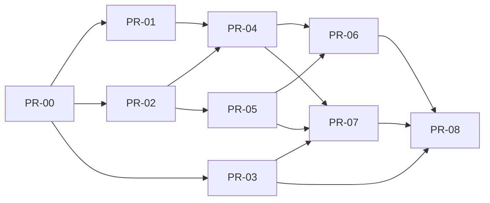

# PR plan: Full balance payment (CL-3, slice 1)

Lane M (committed size L), PR budget 8 (excluding PR-00): **8 PRs** in 4 waves after the skeleton.
`max_parallel_coders` = 4. Risk class R2: PR-01 and PR-04 are the tier-3 money paths (`src/CardLab.Domain`).

## Ticket
Ticket key **`CL-3`** (shared by the four CL-3 slices). Every PR title is `CL-3 PR-NN: <title>` and every PR body
starts with `Ticket: CL-3` (template `.github/pull_request_template.md`; CI `ticket-key` check, pattern `CL-\d+`).

## Waves
<!-- Wave N may start when every PR in its Depends-on is merged. PRs in the same wave run in
parallel and MUST own disjoint files. PR-00 (skeleton) is always wave 0. -->

| PR | Title | Wave | Depends on | Owns (exact files, comma-separated) | Covers (AC ids) | Tests (ids) | Size |
|----|-------|------|------------|-------------------------------------|-----------------|-------------|------|
| PR-00 | Skeleton, shared wiring and plan | 0 | - | (all skeleton files; see *Skeleton contents*) | - | - | L |
| PR-01 | Payment domain rules: balance, quote, confirm, lifecycle, wording v1 | 1 | PR-00 | `src/CardLab.Domain/Money/Money.cs`, `src/CardLab.Domain/Payments/PaymentReference.cs`, `src/CardLab.Domain/Payments/BalanceRules.cs`, `src/CardLab.Domain/Payments/QuoteRules.cs`, `src/CardLab.Domain/Payments/ConfirmRules.cs`, `src/CardLab.Domain/Payments/PaymentStateMachine.cs`, `src/CardLab.Domain/Payments/WordingV1.cs`, `src/CardLab.Domain/Payments/PaymentWireNames.cs`, `tests/CardLab.Domain.Tests/Payments/BalanceRulesTests.cs`, `tests/CardLab.Domain.Tests/Payments/WordingTests.cs`, `tests/CardLab.Domain.Tests/Payments/ConfirmRulesTests.cs`, `tests/CardLab.Domain.Tests/Payments/PaymentStateMachineTests.cs`, `tests/CardLab.Domain.Tests/Payments/PaymentReferenceTests.cs`, `tests/CardLab.Domain.Tests/Payments/QuoteRulesTests.cs`, `tests/CardLab.Domain.Tests/Payments/PaymentWireNamesTests.cs`, `tests/CardLab.Domain.Tests/Money/MoneyDisplayTests.cs`, `tests/CardLab.Domain.Tests/Generators/PaymentArbitraries.cs`, `tests/CardLab.Domain.Tests/Properties/PaymentProperties.cs` | AC-1, AC-3, AC-5, AC-6, AC-11, AC-17, AC-24, AC-25, AC-29 | T-U-1, T-U-2, T-U-3, T-U-4, T-U-5, T-U-6, T-U-7, T-U-8, T-U-9, T-U-32, T-U-33, T-U-34, T-U-35, T-U-36, T-P-1, T-P-2, T-P-3, T-P-4 | M |
| PR-02 | Payment test harness: in-memory store, scriptable bank, contract suites | 1 | PR-00 | `tests/CardLab.TestKit/Fakes/InMemoryCardStore.cs`, `tests/CardLab.TestKit/Fakes/FakeBank.cs`, `tests/CardLab.TestKit/Fakes/Fakes.cs`, `tests/CardLab.TestKit/Contracts/PaymentStoreContractTests.cs`, `tests/CardLab.TestKit/Contracts/CurrentAccountBankContractTests.cs`, `tests/CardLab.TestKit/PanScanner.cs`, `tests/CardLab.Domain.Tests/Fakes/InMemoryPaymentStoreContractTests.cs`, `tests/CardLab.Domain.Tests/Fakes/FakeBankContractTests.cs`, `tests/CardLab.Domain.Tests/Harness/PaymentHarnessTests.cs` | AC-3, AC-31 | T-U-23, T-U-24, T-U-37 | L |
| PR-03 | Cardholder web journey: view, review, receipt, fake-bank panel, API clients | 1 | PR-00 | `web/src/api/httpApiClient.ts`, `web/src/api/httpApiClient.test.ts`, `web/src/api/fakeApiClient.ts`, `web/src/api/fakeApiClient.test.ts`, `web/src/components/CardholderShell.tsx`, `web/src/pages/cardholder/CardholderViewPage.tsx`, `web/src/pages/cardholder/ReviewPage.tsx`, `web/src/pages/cardholder/ReceiptPage.tsx`, `web/src/pages/cardholder/FakeBankPanel.tsx`, `web/src/pages/cardholder/Cardholder.module.css`, `web/src/pages/cardholder/CardholderView.test.tsx`, `web/src/pages/cardholder/Review.test.tsx`, `web/src/pages/cardholder/Receipt.test.tsx`, `web/src/pages/cardholder/FakeBankPanel.test.tsx`, `web/src/pages/CardListPage.tsx`, `web/src/pages/CardListPage.module.css`, `web/src/pages/CardListPage.test.tsx`, `web/src/format/money.test.ts` | AC-4, AC-5, AC-6, AC-7, AC-11, AC-12, AC-13, AC-16, AC-24, AC-33, AC-34 | T-W-1, T-W-2, T-W-3, T-W-4, T-W-5, T-W-7, T-W-9, T-W-10 | L |
| PR-04 | Payment application services: quote, three-step confirm, status check, view | 2 | PR-01, PR-02 | `src/CardLab.Domain/Application/PaymentService.cs`, `src/CardLab.Domain/Application/CardholderViewService.cs`, `src/CardLab.Domain/Application/InFlightPayments.cs`, `tests/CardLab.Domain.Tests/Application/PaymentServiceTests.cs`, `tests/CardLab.Domain.Tests/Application/PaymentStatusCheckTests.cs`, `tests/CardLab.Domain.Tests/Application/CardholderViewServiceTests.cs`, `tests/CardLab.Domain.Tests/Application/InFlightPaymentsTests.cs` | AC-1, AC-4, AC-5, AC-6, AC-7, AC-8, AC-9, AC-10, AC-11, AC-12, AC-13, AC-14, AC-15, AC-16, AC-24, AC-27, AC-30, AC-34, AC-35, AC-36, AC-38 | T-U-10, T-U-11, T-U-12, T-U-13, T-U-14, T-U-15, T-U-16, T-U-17, T-U-18, T-U-19, T-U-20, T-U-21, T-U-22, T-U-25, T-U-26, T-U-27, T-U-28, T-U-29, T-U-30, T-U-31, T-U-38, T-U-39, T-U-40, T-U-41 | L |
| PR-05 | SQL payment store, persisted fake bank, migration, seed and reset | 2 | PR-02 | `src/CardLab.Infrastructure/Model/CardLabDbContext.cs`, `src/CardLab.Infrastructure/Model/PaymentEntities.cs`, `src/CardLab.Infrastructure/FakeBank/BankEntities.cs`, `src/CardLab.Infrastructure/Migrations/20261107000000_AddPayments.cs`, `src/CardLab.Infrastructure/Migrations/20261107000000_AddPayments.Designer.cs`, `src/CardLab.Infrastructure/Migrations/CardLabDbContextModelSnapshot.cs`, `src/CardLab.Infrastructure/Sql/SqlCardStore.cs`, `src/CardLab.Infrastructure/Sql/SqlCardWriter.cs`, `src/CardLab.Infrastructure/Sql/DatabaseSetup.cs`, `src/CardLab.Infrastructure/Sql/DatabaseProbe.cs`, `src/CardLab.Infrastructure/Payments/SqlPaymentWriter.cs`, `src/CardLab.Infrastructure/Payments/SystemPaymentReferences.cs`, `src/CardLab.Infrastructure/FakeBank/SqlFakeBank.cs`, `tests/CardLab.Integration.Tests/Store/SqlPaymentStoreContractTests.cs`, `tests/CardLab.Integration.Tests/Payments/FakeBankContractTests.cs`, `tests/CardLab.Integration.Tests/Payments/FakeBankSteeringTests.cs`, `tests/CardLab.Integration.Tests/Payments/FakeBankPersistenceTests.cs`, `tests/CardLab.Integration.Tests/Payments/SystemPaymentReferencesTests.cs`, `tests/CardLab.Integration.Tests/Api/TestEndpointsTests.cs` | AC-21, AC-22, AC-31, AC-32, AC-33, AC-37 | T-I-11, T-I-12, T-I-15, T-I-16, T-I-20, T-I-22, T-I-23 | L |
| PR-06 | Cardholder and fake-bank API with payment-flow integration tests | 3 | PR-04, PR-05 | `src/CardLab.Api/Endpoints/CardholderEndpoints.cs`, `src/CardLab.Api/Endpoints/FakeBankEndpoints.cs`, `tests/CardLab.Integration.Tests/Payments/CardholderViewEndpointTests.cs`, `tests/CardLab.Integration.Tests/Payments/ConfirmEndpointTests.cs`, `tests/CardLab.Integration.Tests/Payments/ConfirmRefusalTests.cs`, `tests/CardLab.Integration.Tests/Payments/IdempotencyTests.cs`, `tests/CardLab.Integration.Tests/Payments/TimeoutTests.cs`, `tests/CardLab.Integration.Tests/Payments/StatusCheckTests.cs`, `tests/CardLab.Integration.Tests/Payments/LimitsUnaffectedTests.cs`, `tests/CardLab.Integration.Tests/Payments/FakeBankEndpointTests.cs`, `tests/CardLab.Integration.Tests/Performance/CardholderViewLatencyTests.cs` | AC-1, AC-2, AC-4, AC-5, AC-7, AC-8, AC-9, AC-10, AC-13, AC-14, AC-15, AC-16, AC-19, AC-30, AC-31, AC-32, AC-34, AC-36 | T-I-1, T-I-2, T-I-3, T-I-4, T-I-5, T-I-6, T-I-7, T-I-9, T-I-17, T-I-21 | L |
| PR-07 | Admin payment visibility: balance, activity, payments list and record (API + web) | 3 | PR-03, PR-04, PR-05 | `src/CardLab.Api/Endpoints/CardEndpoints.cs`, `web/src/pages/CardDetailPage.tsx`, `web/src/pages/CardDetailPage.module.css`, `web/src/pages/cardDetail/sections.tsx`, `web/src/pages/cardDetail/paymentSections.tsx`, `web/src/pages/CardDetail.test.tsx`, `web/src/pages/PaymentRecordPage.tsx`, `web/src/pages/PaymentRecordPage.module.css`, `web/src/pages/PaymentRecord.test.tsx`, `tests/e2e/src/pages/CardDetailPage.ts`, `tests/CardLab.Integration.Tests/Payments/PaymentRecordEndpointTests.cs`, `tests/CardLab.Integration.Tests/Payments/AdminPaymentEndpointsTests.cs` | AC-1, AC-2, AC-20, AC-34 | T-I-10, T-I-19, T-W-6, T-W-8 | L |
| PR-08 | End-to-end payment journeys, deploy smoke and cross-path checks | 4 | PR-03, PR-06, PR-07 | `tests/e2e/src/api.ts`, `tests/e2e/src/panScanner.ts`, `tests/e2e/src/pages/CardholderPage.ts`, `tests/e2e/src/pages/ReviewPage.ts`, `tests/e2e/src/pages/ReceiptPage.ts`, `tests/e2e/src/pages/PaymentRecordPage.ts`, `tests/e2e/src/payments/pay.spec.ts`, `tests/e2e/src/payments/edge.spec.ts`, `tests/e2e/src/payments/pending.spec.ts`, `tests/e2e/src/payments/privacy.spec.ts`, `tests/e2e/src/payments/a11y.spec.ts`, `tests/e2e/src/payments/record.spec.ts`, `tests/e2e/src/smoke/pay.spec.ts`, `tests/CardLab.Integration.Tests/Payments/BothSidesTests.cs`, `tests/CardLab.Integration.Tests/Privacy/NoPanTests.cs`, `tests/CardLab.Integration.Tests/Logging/PaymentEventTests.cs`, `tests/CardLab.Integration.Tests/Payments/OriginMarkerTests.cs` | AC-4, AC-5, AC-6, AC-7, AC-8, AC-11, AC-12, AC-13, AC-14, AC-18, AC-20, AC-23, AC-26, AC-27, AC-28, AC-33, AC-34, AC-35 | T-E-1, T-E-2, T-E-3, T-E-4, T-E-5, T-E-6, T-E-7, T-I-8, T-I-13, T-I-14, T-I-18 | L |

## Dependency graph

| Wave | PRs | Parallel coders |
|---|---|---|
| 1 | PR-01 domain rules, PR-02 harness, PR-03 cardholder web | 3 |
| 2 | PR-04 application services, PR-05 SQL store + fake bank | 2 |
| 3 | PR-06 cardholder/fake-bank API, PR-07 admin visibility | 2 |
| 4 | PR-08 E2E + cross-path checks | 1 |

## Critical path & parallelism
- Critical path: PR-00 → PR-01 / PR-02 → PR-04 → PR-06 → PR-08 (4 waves after the skeleton).
- Max parallel coders: 3 (wave 1), under `max_parallel_coders` 4.
- Why these boundaries: the pure money rules (PR-01, tier 3) and the harness (PR-02) are independent once PR-00 fixes
  the types and the shared builders, so both run first; the application services (PR-04, tier 3) need both; the SQL
  adapters (PR-05) need only the contract suites; the HTTP surface splits into the cardholder journey (PR-06) and the
  admin vertical slice (PR-07: endpoints + admin pages + the 001 page object it renames), which arranges data through
  `PaymentService` from a host scope so it does not wait for PR-06; web runs from wave 1 on `FakeApiClient`; PR-08 is
  test-only (E2E + four cross-path integration classes that need both API PRs).
- Budget: 8 of 8. No S-sized PR. PR-02 and PR-08 are test-only (reviewer `pr-light`); PR-01 and PR-04 get the tier-3
  review. PR-05 is the largest production PR (one module, generated migration excluded from line counts).

## Skeleton contents (PR-00)
Complete in PR-00 (no later PR edits them):
- **Domain types and ports:** `src/CardLab.Domain/Payments/PaymentTypes.cs`, `Quote.cs`, `BankOutcome.cs`,
  `PaymentRecords.cs`; `src/CardLab.Domain/Ports/ICurrentAccountBank.cs` (`ICurrentAccountBank`, `BankAccountRef`,
  `AccountSnapshot`, `BankEntry`, `DebitRequest`, `IPaymentReferences`, `IPaymentWriter`); `Ports/ICardStore.cs` (five
  new reads + `ICardWriter.Payments`); `Application/PaymentModels.cs` (`Receipt`, `PaymentError`, `CardholderView`,
  `PaymentOptions`); `Application/CardLabEvents.cs` (EventIds 1003-1005).
- **Infrastructure wiring:** `DependencyInjection.cs` (fake bank as both ports, references, in-flight registry,
  services, `PaymentOptions` binding), `Options/CardLabOptions.cs` (`SeedLinkedAccountOptions`),
  `FakeBank/Steering.cs` (`IFakeBankSteering`, `Steering`, `NextDebitOutcome`, `NextStatusCheck`).
- **Api:** `Program.cs` (maps cardholder and fake-bank endpoints), `appsettings.json` (`Seed:LinkedAccount`,
  `Payments`), `Contracts/PaymentContracts.cs` (all §7 DTOs), `Contracts/PaymentDtoMapper.cs` (domain → wire mapping
  shared by PR-06 and PR-07), `Contracts/WireContracts.cs` (`CardDetailDto.BalanceOwed`, optional so 001 code keeps
  compiling); route tables of `CardholderEndpoints`, `FakeBankEndpoints` and the three new `CardEndpoints` routes.
- **Harness:** `tests/CardLab.TestKit/Seed.cs` (linked account constants), `tests/CardLab.TestKit/Builders/PaymentBuilders.cs`
  (`QuoteBuilder`, `PaymentBuilder`, `LinkedAccountBuilder`, `BankOutcomes`), integration `Harness/ApiClient.cs` (10 typed
  payment calls, `ProblemAs<T>()`), `Harness/ApiFactory.cs` (`ApiFactoryWithShortBankTimeout`, `CreateRestartedHost()`),
  `Harness/SqlTestDatabase.cs` (linked-account seed options, `CountRowsAsync`, `ExecuteAsync`).
- **Web:** `api/types.ts`, `api/apiClient.ts`, `App.tsx` (layout routes), `components/AppShell.tsx` (renders `<Outlet/>`),
  `components/Badge.tsx` + `.module.css` (pending/completed/failed tones), `styles/tokens.css` (pending tokens),
  `format/labels.ts` (payment labels, steering option lists), `notImplemented.ts`; `balanceOwed: '0.00'` added to 001
  test seeds so typecheck passes.
- **E2E:** `tests/e2e/src/seed.ts` (linked account), `tests/e2e/src/notImplemented.ts`.

Stubs (`NotImplementedException("PR-NN")` / `notImplemented('PR-NN')`) and test stubs (`[Fact(Skip = "todo")]`,
`[Property(Skip = "todo")]`, `test.todo`, `test.fixme` for Playwright) exist for every owned file above, except the
four new PR-05 files (`Model/PaymentEntities.cs`, `FakeBank/BankEntities.cs`, the two `AddPayments` migration files),
which PR-05 creates. Skeleton gate (2026-11-07): `dotnet build CardLab.sln -warnaserror` 0 warnings; domain 148 passed /
62 skipped; web 58 passed / 19 todo; integration 66 passed / 51 skipped (host starts with the new routes); `dotnet
format`, ESLint, Prettier and `tsc` (web, e2e) clean.

## Shared files
Fully written in PR-00 so later PRs never touch them: DI (`DependencyInjection.cs`), host pipeline and route
registration (`Program.cs`, route tables inside the endpoint files; only handler bodies are owned), options and
`appsettings.json`, log event definitions (`CardLabEvents.cs`), wire DTOs and the DTO mapper, `ICardStore` /
`IPaymentWriter` / `ICurrentAccountBank` interfaces and all payment records, the typed integration `ApiClient`,
`ApiFactory`, `SqlTestDatabase`, `PaymentBuilders`, seed constants (C#, TS, `appsettings.json`), the SPA's `types.ts` /
`apiClient.ts` / `App.tsx` / `AppShell.tsx` / `Badge` / `tokens.css` / `labels.ts`.

## Risks for coding
- **Fake-bank boundary (reviewer rule, DEC-2):** no query may join `Bank*` tables with card or payment tables; the
  fake bank reads and writes only its own tables, inside its own transaction.
- **Money code only under `src/CardLab.Domain`:** endpoints, SQL and SPA never compute balances, fees or wording.
- **Wording is verbatim (NFR-7):** W-1..W-10 live only in `WordingV1`; the SPA shows server strings; PR-01's brief
  pastes §17 and T-U-5/T-U-32 compare character for character.
- **Lock discipline (DEC-3):** never call the bank inside `WithCardLockAsync`; budget token alone means "unanswered";
  settle with `CancellationToken.None`.
- **Migration file names are fixed** (`20261107000000_AddPayments*`); PR-05 renames the generated files and must leave
  the model snapshot matching (EF's pending-model-changes check fails startup otherwise).
- **001 E2E page object:** PR-07 renames the admin "Transactions" heading to "Activity" but keeps the table caption
  "Transaction history" and updates `tests/e2e/src/pages/CardDetailPage.ts` so 001 specs stay green.
- **Real 10 s wait:** four E2E waits use the real budget (T-E-3 twice, T-E-5, T-E-6); integration tests use `ApiFactoryWithShortBankTimeout` (1 s).
- **Public repo:** fictional data only; never name a real company; no absolute paths outside the repo in files.
